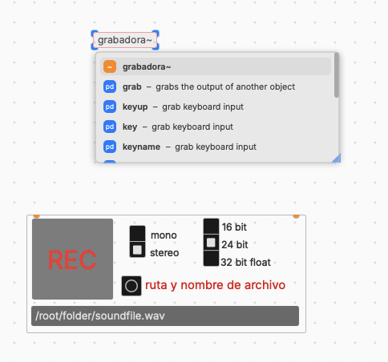

# E2 · Canon de velocidades

!!! tip "Consigna"
    Construye un instrumento en el que **varias voces (de 2 a 4) leen la misma melodía a velocidades distintas**, con **una sola velocidad maestra** que las mueve a todas a la vez. Tócalo cruzando el umbral entre ritmo y altura: de una polifonía de melodías a un solo sonido, y de vuelta. Graba una toma de **60 a 120 segundos**.

**De clase traes** la melodía en una tabla (grados de una escala), el sinte de tabla de ondas y una voz leída por `[phasor~]`, sumada en un bus con `[throw~]` y `[catch~]`. **En casa** escribes tu melodía, dibujas tu forma de onda, añades las demás voces, eliges sus proporciones y grabas.

**Entrega:** antes del domingo 8 de noviembre.

!!! info "Instrumento y toma"
    Desde E2, cada encargo es **un instrumento**: un patch que se toca (con el ratón, el teclado del ordenador o un controlador MIDI), no un patch que se ejecuta y se escucha. Y una **toma**: una grabación en la que lo tocas. Se valora el instrumento, la toma y la defensa.

## Condiciones

- **Una melodía, varias lecturas.** Todas las voces leen la misma tabla. Lo que cambia entre ellas es la **proporción** de velocidad (y, si quieres, la transposición y el punto de partida).
- **Las proporciones las eliges tú**, y son la decisión central del encargo. Dos caminos, o una mezcla:
    - **Proporciones simples** (1, 3/2, 5/4, 2…): a velocidad lenta, un canon de tempos como los de Nancarrow; acelerado, esas mismas proporciones se oyen como un acorde (Cowell).
    - **Proporciones casi iguales** (1, 1,01, 1,02…): las voces empiezan juntas y se van separando poco a poco, hasta que la línea se disuelve en una masa (la micropolifonía de Ligeti).
- **Una sola velocidad maestra**, que tocas tú mientras grabas: un *slider* en escala logarítmica (como en clase), de unas 0,2 vueltas por segundo a varios cientos. Si tienes un controlador MIDI, puedes tocarla con un potenciómetro (`[ctlin]`). **La toma cruza el umbral al menos una vez en cada sentido.**
- **El lector es `[phasor~]`**: cada voz lee la melodía con `[tabread~]`, la pasa por la escala y por `[mtof~]`, y suena con **tu sinte de tabla de ondas** (una forma de onda dibujada o calculada por ti).
- **Un bus**: cada voz termina en `[throw~]` y un solo `[catch~]` las suma antes del `[dac~]`. Baja el volumen en proporción al número de voces: cuatro voces a 1 saturan.
- Como mucho **cuatro voces**, copiadas a mano. En la S6 veremos cómo no tener que hacerlo.
- Cualquier objeto de plugdata de serie, si sabes explicarlo.

## Entrega

En tu carpeta de la asignatura en Google Drive:

1. `apellido-E2.pd` — el instrumento.
2. `apellido-E2.wav` — la **toma** (ver el anexo, «Grabar la toma»).
3. **Tarjeta de decisiones** (unas 5 líneas): tres decisiones que tomaste y por qué (al menos una, sobre las proporciones); algo que intentaste y no funcionó, y qué cambiaste a partir de ahí.

## Defensa

El 8 de noviembre, al comienzo de la sesión, algunas personas elegidas al azar:

1. Tocan el instrumento.
2. Explican sus proporciones: qué se oye de ellas despacio y qué se oye por encima de 20 vueltas por segundo.
3. Hacen en directo una modificación que les pediré.

## Para la próxima sesión

Para la S3 (8 de noviembre), trae **tres a cinco sonidos grabados por ti** (voz, objetos, instrumento, calle), de entre 2 y 20 segundos, en cualquier formato. Serán tu material de trabajo hasta enero. En la S3 los leeremos con el mismo `[phasor~]` que lee tu melodía.

## Anexo · Grabar la toma

Es la primera vez que grabas lo que suena en tu patch. Dos maneras:

**1. Desde el propio patch, con `grabadora~`.** La más directa.

1. Descarga las [utilidades del curso](../recursos.md#utilidades) y guarda `grabadora~.pd` **en la misma carpeta que tu patch**. Pd busca primero ahí los objetos que no conoce.
2. En tu patch, crea un objeto `[grabadora~]`. Es un patch que se usa como un objeto. En la S6 veremos cómo hacer los tuyos; por ahora, basta con usarlo.
3. Conecta a sus dos entradas lo mismo que conectas a `[dac~]`: la salida del `[catch~]`, ya con el volumen.
4. Elige mono o estéreo y la resolución (24 bits está bien). Pulsa **ruta y nombre de archivo** y escribe `apellido-E2.wav`.
5. Con el DSP encendido, activa **REC**, toca, y desactívalo al terminar. El archivo se cierra al parar.

<!-- captura de Anxe: grabadora~ conectada a la salida del sinte, junto al [dac~] -->

**2. En la DAW.** Con plugdata como instrumento en una pista, el patch suena por esa pista: grábala como cualquier instrumento y guarda el resultado como `apellido-E2.wav`.

Escucha el archivo antes de entregarlo: si está en silencio, el DSP estaba apagado o la grabadora no estaba conectada.
