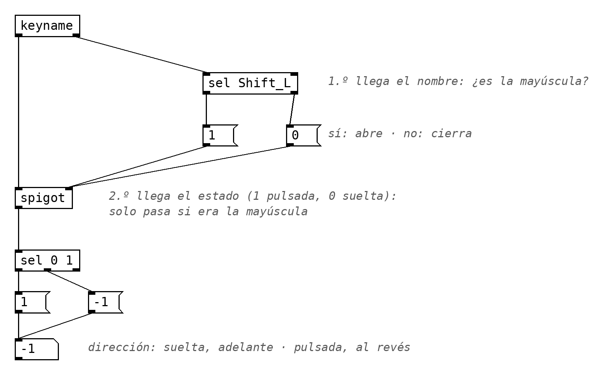

# E3 · Sampler

!!! tip "Consigna"
    **Graba tus sonidos** y construye con ellos un **sampler para el teclado del ordenador**: cada tecla dispara un fragmento con su comienzo, su duración, su velocidad y su dirección. Con él, compón **por capas**: graba una línea tocándolo, después otra, y otra, y móntalas juntas. El resultado, de **60 a 90 segundos**, es tu toma.

**Entrega:** antes del sábado 28 de noviembre. La defensa será el 5 de diciembre (el 28 hay prueba de nivel).

!!! info "Instrumento y toma"
    Desde E2, cada encargo es **un instrumento**: un patch que se toca (con el ratón, el teclado del ordenador o un controlador MIDI), no un patch que se ejecuta y se escucha. Y una **toma**: una grabación en la que lo tocas. Se valora el instrumento, la toma y la defensa.

**De clase traes** el lector con `[phasor~]` y `[tabread4~]`, la lectura de una vez con `[vline~]`, el teclado (`[keymap]`), cada tecla con su fragmento y la envolvente contra los clics. **En casa** grabas tu material, eliges los fragmentos, decides qué hace cada tecla, tocas las capas y las montas.

## Tus sonidos

Graba **de tres a cinco sonidos** de entre 2 y 20 segundos: voz, objetos cotidianos, un instrumento, la calle. Con el móvil basta, en cualquier formato (`[sfload]` los carga todos). Busca sonidos con vida interna: un ataque claro, una frase, un roce que cambia. Serán tu material de trabajo hasta enero.

## Condiciones

- Solo tu material grabado.
- La lectura la haces tú: `[phasor~]` o `[vline~]` con `[tabread4~]`. Puedes cargar con `[sfload]`.
- El sampler es de una voz: una tecla nueva corta a la anterior. La polifonía la consigues por capas en el DAW, usando técnicas de montaje asociadas con las práctica de la música concreta.   
- **Cada capa es una toma tocada** con el sampler. El montaje lo haces en tu DAW.
- Entre dos y cuatro capas.
- El teclado no tiene velocidad: piensa otra manera de tener dinámica.

## Pensar el teclado

Un teclado sugiere notas: una tecla, una altura. Es una opción, no la única. Antes de programar, decide **qué significa una tecla** en tu instrumento. Algunas posibilidades, que se pueden mezclar:

- **Una altura.** Un mismo fragmento, y cada tecla lo transporta: velocidad = 2^((nota − 60)/12). El *sampler* clásico, el de Derbyshire.
- **Un lugar.** Un solo sonido largo, repartido a lo largo del teclado: la tecla de más a la izquierda empieza a leerlo al principio, y cada tecla hacia la derecha, un poco más adelante. El orden de las teclas es el orden del sonido, y recorrer el teclado es recorrer la grabación.
- **Un objeto sonoro.** Cada tecla, una tabla distinta: otro de tus sonidos, cada uno cargado con su `[sfload]`. O un trozo elegido a mano: un golpe, una palabra, un roce. Entre las teclas no hay orden: es una paleta.
- **Un gesto.** La tecla decide cómo se lee: hacia delante o hacia atrás, rápido o lento, una vez o en bucle.

Y un **modificador** cambia el significado de todas las teclas a la vez: mientras mantienes pulsada la mayúscula, todo se lee al revés, o una octava abajo, o en bucle. `[keymap]` no se entera de la mayúscula (la z sigue siendo la z), así que se pueden usar las dos cosas a la vez. Para saber si está pulsada, `[keyname]` (vanilla): por la derecha saca el nombre de la tecla (la mayúscula izquierda es `Shift_L`; compruébalo con un `[print]`) y por la izquierda, 1 al pulsar y 0 al soltar. El nombre llega primero: con `[sel Shift_L]` abres o cierras un `[spigot]` (con `[1(` o `[0(` por su entrada derecha), y el 1 o el 0 que llega después solo pasa si era la mayúscula. Ese 1 o 0 decide la dirección, la octava o lo que quieras.

Dos objetos nuevos, en dos líneas:

- **`[spigot]`** es una puerta: lo que entra por la izquierda solo sale si por la derecha le ha llegado un número distinto de 0. Con 0, se cierra.
- **`[keyname]`** dice qué tecla pulsas o sueltas, también las que no escriben letras. El nombre de cada tecla depende del sistema: conecta un `[print]` a su salida derecha, pulsa la mayúscula y lee en la consola cómo se llama en tu ordenador. Ese es el nombre que va en el `[sel]`.

{ width="819" }

El orden es la clave: `[keyname]`, como todos los objetos de Pd, saca primero por la derecha. Por eso el nombre llega antes que el estado, y el `[spigot]` ya está abierto o cerrado cuando llega el 1 o el 0. Las demás teclas (la z, la s…) cierran el `[spigot]`: su 1 o su 0 no pasa.

## Referencias

Delia Derbyshire, *Doctor Who* (1963): cada nota, un fragmento de cinta a otra velocidad, y la sintonía montada por capas · Stefan Prins, *Piano Hero #1* (2011) · Sarah Nemtsov, *Seven Thoughts – Her Kind* (2018).

## Entrega

En tu carpeta de la asignatura en Google Drive:

1. `apellido-E3.pd` — el instrumento (con sus abstracciones, si las hay), y tus sonidos.
2. `apellido-E3-capa1.wav`, `apellido-E3-capa2.wav`… — cada capa, tal como la tocaste.
3. `apellido-E3.wav` — la **toma**: el montaje de las capas.
4. **Tarjeta de decisiones** (unas 5 líneas): tres decisiones que tomaste y por qué; algo que intentaste y no funcionó, y qué cambiaste a partir de ahí.

## Defensa

El 5 de diciembre, al comienzo de la sesión, algunas personas elegidas al azar:

1. Tocan el instrumento.
2. Explican una decisión señalándola en el patch.
3. Hacen en directo una modificación que les pediré.
