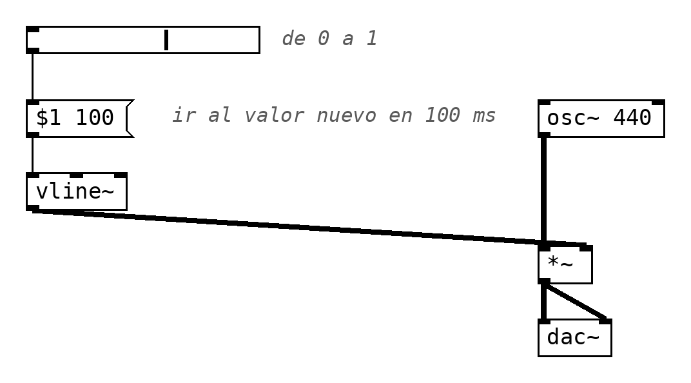

# S2 · Teoría musical, procesado simbólico y MIDI

!!! note "Sesión 2 · sábado 31 de octubre de 2026"
    **Antes de venir:** entrega [E1](../encargos/e1.md) y trae el patch abierto: puede tocarte defenderlo. Trae la DAW preparada como en la S1.

¿Cuándo deja un ritmo de ser ritmo?

<ol>
<li data-src="audio/s2/dufay-nuper-rosarum-flores.mp3"><b>Guillaume Du Fay</b> · <i>Nuper rosarum flores</i> (1436)</li>
<li data-src="audio/s2/crawford-seeger-mixed-accents.mp3"><b>Ruth Crawford</b> · <i>Piano Study in Mixed Accents</i> (1930)</li>
<li data-src="audio/s2/crawford-seeger-string-quartet-1931.mp3"><b>Ruth Crawford</b> · <i>String Quartet 1931</i>, IV. <i>Allegro possibile</i></li>
<li data-src="audio/s2/nancarrow-study-21.mp3"><b>Conlon Nancarrow</b> · <i>Study No. 21 «Canon X»</i> (c. 1960)</li>
<li data-src="audio/s2/spiegel-unseen-worlds.mp3"><b>Laurie Spiegel</b> · <i>From a Harmonic Algorithm</i> (<i>Unseen Worlds</i>, 1991)</li>
</ol>

[Guía de escucha →](../escuchas/s2.md){ .radio-guia }

En la S1 trabajamos con **una nota**: un número que se transporta, se invierte o se elige al azar dentro de una escala. Hoy trabajamos con **muchas notas en el tiempo**: secuencias, ciclos que se superponen, tempos que conviven. Y al final de la tarde llevaremos el tiempo a su límite, hasta que el ritmo deje de ser ritmo y se convierta en sonido.

## Plan de la sesión

**Mañana**

1. Defensa de encargos (E1).
2. Taller de predicción, para repasar la S1: antes de hacer clic, decimos qué va a pasar.
3. La tabla como partitura: leerla, dibujarla y cuantizarla (grados de una escala, semicorcheas). Una técnica: la isorritmia (dos tablas de distinta longitud, dos contadores).
4. Taller: tu partitura, y tocar el secuenciador desde la DAW o un teclado: el MIDI que entra.

**Tarde**

1. Escucha: Conlon Nancarrow, *Study No. 21 «Canon X»* · Laurie Spiegel, *From a Harmonic Algorithm* (1991). ¿Cuándo deja un ritmo de ser ritmo?
2. Del ritmo a la altura: acelerar el secuenciador hasta que las notas dejan de oírse como notas. El paso a la señal: `[phasor~]` lee una forma de onda dibujada en una tabla. La misma tabla y el mismo índice de la mañana, cien veces más rápido: el primer sinte propio.
3. Varias voces, una melodía: `[phasor~]` lee también la partitura, y cada voz la lee a su velocidad. El bus: `[throw~]` y `[catch~]`.
4. Taller: empezamos el [E2](../encargos/e2.md). En clase, juntas: una voz leída por `[phasor~]`, con tu sinte de tabla de ondas, en el bus. En casa: tu melodía, tu forma de onda, las demás voces, sus proporciones y la toma.

## Taller de predicción: repaso de la S1

El taller aparece aquí al empezar la clase.

## Contenidos de referencia

### Mañana: la tabla como partitura

Una tabla (`[array]`) es una lista de números con un índice. La escala que en la S1 hacíamos con `[sel]` y mensajes cabe en una tabla de siete números, y `[tabread]` la lee: más corto, y se puede cambiar sin tocar el patch. Si cada número es una nota y el índice lo da el contador de la S1, la tabla es una **partitura**: el contador avanza, la tabla responde con la nota que toca en cada paso.

{ width="729" }

La tabla se escribe con el ratón: en modo ejecución, dibuja sobre ella. En sus propiedades (clic derecho) decides cuántas casillas tiene y su rango vertical.

#### Cuantizar: la tabla guarda índices

Lo que dibujas con el ratón no cae en ninguna nota ni en ningún compás: la tabla guarda 2,6 o 4,1, y una duración de 287 ms. Para trabajar en una escala o en una métrica cerrada, la tabla no guarda notas ni milisegundos, sino **índices**:

- La partitura guarda **grados** (de 0 a 6). `[int]` se queda con la parte entera, y otra tabla, la **escala**, dice a qué intervalo corresponde cada grado. Cambia la escala y cambias la interválica sin tocar la melodía.
- Las duraciones se guardan en **semicorcheas** (1, 2, 3…) y se multiplican por lo que dura una semicorchea.

{ width="970" }

El `[metro]` cambia de tiempo en cada paso: lo que entra por su derecha vale desde el pulso siguiente. `[max 1]` evita una duración de cero.

#### Cuánto dura una semicorchea

`[metro]` trabaja en milisegundos; la música, en pulsos por minuto. 60.000 ms / bpm = duración de una negra; dividida por 4, una semicorchea.

{ width="726" }

Con `[mod]` y `[sel]` sobre un contador de semicorcheas sabes además en qué parte del compás estás: `[mod 4]` da la posición dentro de la negra; `[mod 16]`, dentro del compás.

#### Una técnica: la isorritmia

En el patch de cuantizar, alturas y duraciones comparten contador: cada nota tiene siempre la misma duración. Dales tablas de distinta longitud y un contador a cada una, y tienes la técnica del motete del siglo XIV.

En el motete isorrítmico del siglo XIV (Machaut, Vitry), un patrón de alturas (*color*) y uno de duraciones (*talea*) de distinta longitud se repiten a la vez. Como no coinciden, cada vuelta combina alturas y duraciones de otra manera, hasta que vuelven a encontrarse en el punto de partida. En Pd: dos tablas de distinta longitud, leídas por dos contadores.

{ width="862" }

!!! question "Predicción"
    Dos contadores avanzan juntos: uno con `[mod 3]`, el otro con `[mod 4]`. ¿Después de cuántos pasos vuelven a estar los dos en 0? ¿Y con `[mod 5]` y `[mod 7]`? ¿Y con `[mod 4]` y `[mod 6]`? Piénsalo antes de comprobarlo.

Con varios `[metro]` a tempos distintos, en lugar de varias tablas, tienes la polirritmia de Nancarrow: está entre los patches de la sesión (`0204b`).

Hay más técnicas que salen igual de una tabla y un contador (retrogradación, acordes): al final de la página, en «Más allá de la clase».

#### Tocar el secuenciador: el MIDI que entra

Hasta ahora Pd mandaba notas. También puede recibirlas: `[notein]` da la altura y la velocidad de lo que llega. Con plugdata dentro de la DAW, es la puerta entre la pista y el patch: las notas de un clip o de un teclado entran por aquí. `[stripnote]` deja pasar solo las notas que empiezan (quita los *note off*).

{ width="618" }

La tecla que tocas transporta la melodía: entra por la entrada fría de `[+]` y vale desde la nota siguiente. Tocar el patch es eso: cambiar los números que esperan en las entradas frías. Sin teclado, un *slider* de −12 a 12 hace lo mismo.

### Tarde: la tabla como forma de onda

#### Para leer: Nancarrow, Cowell y el continuo

Henry Cowell propuso en *New Musical Resources* (escrito en 1919, publicado en 1930) que **ritmo y altura son el mismo fenómeno a distinta velocidad**: una proporción de tempo de 3:2 es la misma que hay entre las dos notas de una quinta. Conlon Nancarrow tomó la idea al pie de la letra. Escribió más de sesenta estudios para pianola, perforando los rollos a mano, con cánones a tempos que ningún pianista podría tocar.

*Detalle de un rollo original del Estudio 49.*

*El Estudio 37: un canon a doce voces con doce tempos distintos, en las proporciones de una escala justa. Ritmo y armonía con los mismos números. Aquí, en el piano roll de una DAW, a partir de la transcripción de la Fundación Paul Sacher.*

La idea es antigua: en la *Missa prolationum*, Ockeghem hace que varias voces lean la misma línea a velocidades distintas.

#### El límite de lo simbólico

Si aceleramos el secuenciador (8 notas por segundo, 16, 30…), hacia las 20 por segundo dejamos de oír notas y empezamos a oír un tono. Pero por ese camino no podemos seguir: los mensajes de control de Pd se calculan entre bloques de audio (cada milisegundo y medio, aproximadamente), y un sinte MIDI no está hecho para recibir cientos de notas por segundo.

Para seguir acelerando necesitamos un pulso que viva a la velocidad del audio. `[phasor~]` es una rampa que va de 0 a 1 una y otra vez: a 2 Hz se oyen golpes; a 200 Hz, una altura. **El ritmo se ha convertido en altura.** Ese mismo `[phasor~]` será, en la S3, el lector de los sonidos grabados.

{ width="812" }

#### Señal frente a control

{ width="678" }

La tilde (`~`) indica que el objeto trabaja con **señal**: un flujo continuo de números a la frecuencia de muestreo (44.100 o 48.000 por segundo), frente a los mensajes de control, que solo existen cuando ocurre algo.

- **Señal (audio rate).** Evaluación continua, al ritmo del reloj de audio. Se enciende y se apaga explícitamente (DSP). Cables gruesos.
- **Control.** Evaluación bajo demanda: algo pasa cuando llega un mensaje. Cables finos.

En plugdata se distinguen también por el color: entradas y salidas naranjas para la señal, azules para el control.

#### Una forma de onda en una tabla

Por la mañana, un contador lento leía una partitura. Ahora, un índice rapidísimo lee una **forma de onda**: `[phasor~]` recorre la tabla entera cientos de veces por segundo, y cada vuelta es un periodo. Las vueltas por segundo son la altura; lo que hay dibujado en la tabla, el timbre.

{ width="834" }

`[phasor~]` va de 0 a 1: multiplicado por 256 recorre las 256 casillas. `[tabread4~]` interpola entre casillas, por eso necesita una de margen a cada lado: el índice va de 1 a 257, y la tabla tiene 259. La forma de onda se dibuja con el ratón, o se calcula con un mensaje: `; onda sinesum 256 1 0.5 0.33` suma armónicos (el 1.º, la mitad del 2.º, un tercio del 3.º…).

`[osc~]` es exactamente esto, con una tabla de coseno que ya trae Pd.

`[mtof]` convierte un número de nota en frecuencia (Hz): las vueltas por segundo que tiene que dar el índice. Por dentro, `[mtof]` calcula 440 · 2^((n − 69)/12): la nota 69 (La4) es la referencia, y cada semitono multiplica la frecuencia por 2^(1/12) ≈ 1,0595. Escrito a mano, puedes cambiar el La (442 Hz) o dividir la octava en algo distinto de doce partes.

#### El primer sinte propio

Lo que en la DAW hacía el sinte por ti (la envolvente, el volumen, la salida) aquí lo construyes: `[vline~]` dibuja la envolvente, `[*~]` la aplica y `[dac~]` manda el resultado a la tarjeta de sonido. El mensaje `1 5, 0 300 5` son dos tramos: ir a 1 en 5 ms; y, 5 ms después de empezar, volver a 0 en 300 ms.

{ width="724" }

La nota llega del secuenciador sin cables: `[s nota]` manda a todos los `[r nota]`. **Los nombres son globales:** un `[send algo]` llega a todos los `[receive algo]` de todos los patches abiertos. Ponles nombres que no choquen.

!!! tip "Ten un espectrograma abierto"
    A partir de hoy, cuando algo suene, míralo además de oírlo. `[spectrograph~]` de ELSE nos acompañará todo el curso: conéctale lo mismo que va al `[dac~]`.

#### Varias voces, una melodía: el canon de velocidades

Por la mañana, un contador leía la partitura nota a nota. Ahora la lee `[phasor~]`: multiplicado por la longitud de la tabla (8), recorre la melodía entera en cada vuelta. `[tabread~]` (sin el 4) no interpola: salta de casilla en casilla, y por eso se oyen notas y no un glissando. Después, la escala, `[mtof~]` (el `[mtof]` de la señal) y el sinte.

<!-- captura de Anxe: una voz, de [r~ velocidad] a [throw~ bus] -->

La frecuencia del `[phasor~]` ya no es una altura: son **vueltas a la melodía por segundo**. A 0,5, una melodía de 8 notas en 2 segundos. A 20, la melodía se convierte en una textura. A 200, la partitura entera cabe en un periodo: se ha convertido en el timbre.

Ahora, varias voces leen la misma tabla, cada una a su velocidad: una sola velocidad maestra (`[s~ velocidad]`), que cada voz multiplica por su proporción. La velocidad se toca con un *slider* en escala logarítmica (propiedades → *log*): en lineal, de 0,2 a 500, todo lo que pasa por debajo de 20 cabría en los primeros milímetros, y es justo la zona que interesa. Es el canon de la *Missa prolationum* y de Nancarrow. Con proporciones simples (1, 3/2, 5/4), al acelerar, la proporción de tempos se convierte en un acorde: lo que decía Cowell. Con proporciones casi iguales (1, 1,01, 1,02), las voces se separan poco a poco hasta que la línea se disuelve en una masa: la micropolifonía de Ligeti. La entrada derecha de `[phasor~]` fija la fase: dónde empieza a leer cada voz.

**El bus.** Cada voz termina en `[throw~ bus]`, y un solo `[catch~ bus]` las suma: un volumen y una salida para todas. Es el `[send]`/`[receive]` de la señal, pero muchos a uno. (`[s~]`/`[r~]` va al revés: uno a muchos, como la velocidad maestra.) Cuatro voces a 1 saturan: el volumen se divide por el número de voces.

Todo está en el patch `0213 Canon de velocidades`.

### Más allá de la clase

Lo que sigue no se explica en clase. Está aquí, con sus patches, para el encargo y para quien quiera más.

#### Más maneras de escribir en una tabla

- **Con un mensaje.** Un mensaje que empieza por punto y coma manda su contenido a un nombre. Este escribe la lista en la tabla «partitura» a partir de la casilla 0:

{ width="628" }

- **Tocando, paso a paso.** `[tabwrite partitura]` escribe el número que le llega por la izquierda (caliente) en la casilla que tiene en la derecha (fría). Con el contador de la S1, cada nota que tocas va a la casilla siguiente: la partitura se toca, no se teclea.

{ width="504" }

#### Más técnicas

**Retrogradación.**

{ width="442" }

La misma cuenta que la inversión de la S1 (120 − nota), aplicada al índice: 7 − paso.

**Acordes.**

La armonía como suma: la fundamental, más una tercera y una quinta, repartidas por `[t f f f]`. Con la tercera en 4, mayor; en 3, menor.

{ width="706" }

Para los acordes, tu sinte necesita una copia por voz, cada una con su `[r]`. ¿Y si fueran dieciséis? En la S6.

#### Escalar un controlador

`[ctlin]` recibe los controladores (potenciómetros, automatizaciones de la DAW), que van de 0 a 127.

{ width="457" }

Un potenciómetro manda valores de 0 a 127; el tempo necesita, por ejemplo, de 60 a 600 ms. Hay que **escalar**: restar el mínimo, dividir por el rango, multiplicar por el rango nuevo y sumar su mínimo. `[scale]` de ELSE lo hace en una caja; conviene saber qué hace dentro.

`[keyboard]` de ELSE es un teclado de piano en pantalla: al hacer clic manda la nota y la velocidad, como `[notein]`.

#### Volumen sin clics

Para cambiar el volumen sin clics, el mismo `[vline~]` va del valor anterior al nuevo en el tiempo que le digas (por ejemplo, 100 ms).

{ width="536" }

??? info "Para saber más (fuera de clase)"
    **Más objetos gráficos.** Botones, *toggles*, *knobs* y cajas de número imitan el hardware de sonido; ELSE añade osciloscopios, vúmetros y espectrogramas.

    { .patch }

    { .patch }

    `[keymap]` de ELSE convierte el teclado del ordenador en un teclado MIDI. En el *object browser* de plugdata, los generadores están en «Signal Generators» y «Random and Noise».

    **Otros mensajes MIDI.** Además de notas, MIDI transporta controladores (`[ctlout]`), cambios de programa (`[pgmout]`), *pitch bend* (`[bendout]`) y *aftertouch*.

    { .patch }

    **Alturas fuera del temperamento** con *pitch bend*:

    { .patch }

    **Pd escuchando a la DAW.** Como plugin, plugdata puede leer la posición del cursor y el tempo de la DAW con `[playhead]`, y exponer parámetros automatizables con `[param]`.

    { .patch }

    { .patch }

    **Lecturas en la red:** [Robert Willey, *Electronic Realizations of Nancarrow's Study No. 37*](http://www.willshare.com/willeyrk/creative/papers/study37/) · [Michael Connor, *The impossible music of Black MIDI*](https://rhizome.org/editorial/2013/sep/23/impossible-music-black-midi/).

## Lo esencial de hoy

| Objetos | Para qué |
|---|---|
| `[array]` · `[tabread]` | Una tabla: partitura, escala, duraciones. Se lee con un índice. |
| `[int]` · `[max]` | Quedarse con la parte entera; poner un mínimo. Cuantizar. |
| `[notein]` · `[stripnote]` | El MIDI que entra: de la pista de la DAW o de un teclado al patch. |
| `[send]` · `[receive]` | Mandar sin cables. Los nombres son globales. |
| `[phasor~]` | Una rampa de 0 a 1: el contador, a velocidad de audio. |
| `[tabread4~]` | Leer una tabla a velocidad de audio, interpolando: una forma de onda. |
| `[mtof]` | De nota a frecuencia. |
| `[vline~]` · `[*~]` | La envolvente, y aplicarla. |
| `[dac~]` | La salida a la tarjeta de sonido. |
| `[tabread~]` · `[mtof~]` | Leer la partitura a velocidad de audio, sin interpolar; de nota a frecuencia, en señal. |
| `[s~]` · `[r~]` · `[throw~]` · `[catch~]` | Señal sin cables: uno a muchos (la velocidad maestra), muchos a uno (el bus). |

- **La tabla es una partitura,** y el contador de la S1, su lector.
- **La tabla guarda índices:** grados de una escala y semicorcheas. Así cualquier trazo suena en la escala y en el compás. El tempo es una división: 60.000 / bpm.
- **Una técnica es aritmética sobre el índice:** la isorritmia son dos contadores con distinto `[mod]`, que tardan en volver a coincidir.
- **Tocar el patch** es cambiar los números que esperan en las entradas frías.
- **Ritmo y altura son el mismo continuo** a distinta velocidad: hacia los 20 golpes por segundo, el ritmo se oye como altura.
- **Señal y control.** La señal (`~`, cable grueso) es un flujo continuo; el control solo existe cuando pasa algo.
- **La misma tabla y el mismo índice, a dos velocidades:** por la mañana, una partitura; por la tarde, una forma de onda.
- **Un canon de velocidades** es una sola melodía leída a varias proporciones: despacio, polifonía; deprisa, un acorde o una masa.

## Patches de referencia

Los patches de referencia de esta sesión se publican aquí al acabar la clase. En clase no se reparten antes: se construyen.

## Para seguir por tu cuenta

**Documentación de Pd**

- `2.control.examples`: 15–16 (arrays), 18 (condicionales), 19 (azar), 23 (secuencias), 24 (bucles).
- `3.audio.examples`: A01–A06 (sinusoide, amplitud, `line~`, salida, frecuencia), B01 (tablas de ondas), D01–D02 (envolventes, ADSR), C01 (Nyquist).

**Live Electronics Tutorial (Porres)**

- *Control › Sequencing*: `Array-Sequencer` (la tabla como partitura) y `Rhythmic`.
- *Control › Trigger-LFO-LFNoise › clock.metronome*: tempo, bpm y `[polymetro]` (varios pulsos a la vez: isorritmia).
- *The Basics › Pd Quickstart › Audio.DSP.Pd*: `AudioXControl-Rate` (señal frente a control).
- *The Basics › Oscillators*: `Sine-Cosine`, `Phasor`, `Frequency`.
- *Control › Lines* (`[line~]`, `[vline~]`) y *Control › Envelopes* (`Classic.Types`: AR, ADSR).
- *The Basics › Amplitude-dB* y *Gain.Adjustment*: amplitud, decibelios y volumen sin clics.

## Encargo

[E2 · Canon de velocidades](../encargos/e2.md), para el domingo 8 de noviembre.
