# S2 · Teoría musical, procesado simbólico y MIDI

!!! note "Sesión 2 · sábado 31 de octubre de 2026"
    **Antes de venir:** entrega [E1](../encargos/e1.md) y trae el patch abierto: puede tocarte defenderlo. Trae la DAW preparada como en la S1.

¿Cuándo deja un ritmo de ser ritmo?

<ol>
<li data-src="audio/s2/dufay-nuper-rosarum-flores.mp3"><b>Guillaume Du Fay</b> · <i>Nuper rosarum flores</i> (1436)</li>
<li data-src="audio/s2/crawford-seeger-mixed-accents.mp3"><b>Ruth Crawford</b> · <i>Piano Study in Mixed Accents</i> (1930)</li>
<li data-src="audio/s2/crawford-seeger-string-quartet-1931.mp3"><b>Ruth Crawford</b> · <i>String Quartet 1931</i>, IV. <i>Allegro possibile</i></li>
<li data-src="audio/s2/nancarrow-study-21.mp3"><b>Conlon Nancarrow</b> · <i>Study No. 21 «Canon X»</i> (c. 1960)</li>
<li data-src="audio/s2/spiegel-unseen-worlds.mp3"><b>Laurie Spiegel</b> · <i>From a Harmonic Algorithm</i> (<i>Unseen Worlds</i>, 1991)</li>
</ol>

[Guía de escucha →](../escuchas/s2.md){ .radio-guia }

En la S1 trabajamos con **una nota**: un número que se transporta, se invierte o se elige al azar dentro de una escala. Hoy trabajamos con **muchas notas en el tiempo**: secuencias, ciclos que se superponen, tempos que conviven. Y al final de la tarde llevaremos el tiempo a su límite, hasta que el ritmo deje de ser ritmo y se convierta en sonido.

## Plan de la sesión

**Mañana**

1. Defensa de encargos (E1).
2. Taller de predicción, para repasar la S1: antes de hacer clic, decimos qué va a pasar.
3. La tabla como partitura: dibujarla, escribirla con mensajes (mandar sin cables) y cuantizarla (grados de una escala, semicorcheas). Una técnica: la isorritmia (dos tablas de distinta longitud, dos contadores). Escucha: Du Fay, *Nuper rosarum flores*.
4. Taller: entre todas, una línea a una voz con técnica isorrítmica, y tocarla desde la pantalla mientras suena: *sliders* para la transposición y el tempo.

**Tarde**

1. Escucha: Conlon Nancarrow, *Study No. 21 «Canon X»* · Laurie Spiegel, *From a Harmonic Algorithm* (1991). ¿Cuándo deja un ritmo de ser ritmo?
2. Del ritmo a la altura: con el *slider* de la mañana, acelerar el secuenciador hasta que las notas dejan de oírse como notas. El paso a la señal: `[phasor~]` lee una forma de onda dibujada en una tabla. La misma tabla y el mismo índice de la mañana, cien veces más rápido: el primer sinte propio.
3. Varias voces, una melodía: `[phasor~]` lee también la partitura, y cada voz la lee a su velocidad. El bus: `[throw~]` y `[catch~]`.
4. Taller: empezamos el [E2](../encargos/e2.md). En clase, juntas: una voz leída por `[phasor~]`, con tu sinte de tabla de ondas, en el bus. En casa: tu melodía, tu forma de onda, las demás voces, sus proporciones y la toma.

## Taller de predicción: repaso de la S1

Cinco patches pequeños con el lenguaje de la S1. Antes de que nadie haga clic, decimos qué va a pasar y por qué. Después se ejecutan y, si no coincide, buscamos dónde falló el porqué: una predicción equivocada con un buen porqué vale más que un acierto por casualidad.

Si no estuviste en clase, hazlo con la [hoja de predicción](img/s1/prediccion/hoja-prediccion-s1.pdf): imprímela o copia sus preguntas en un papel.

??? example "Los cinco patches (imágenes)"
    **01 · derecha-izquierda**

    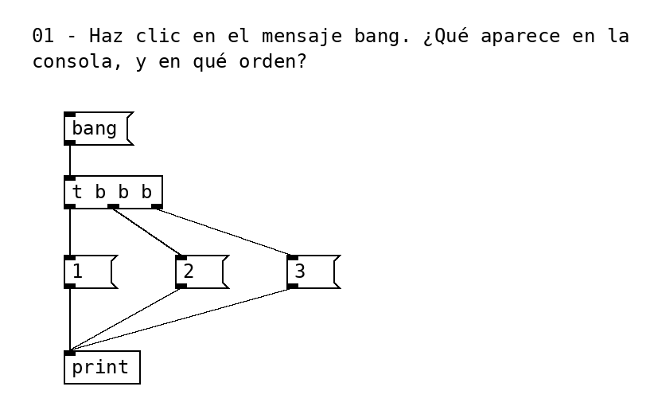

    **02 · caliente-fría**

    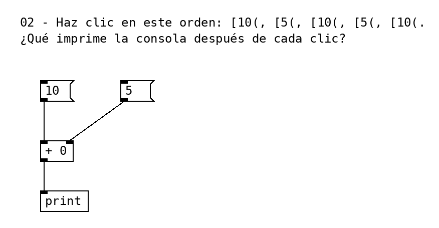

    **03 · contador**

    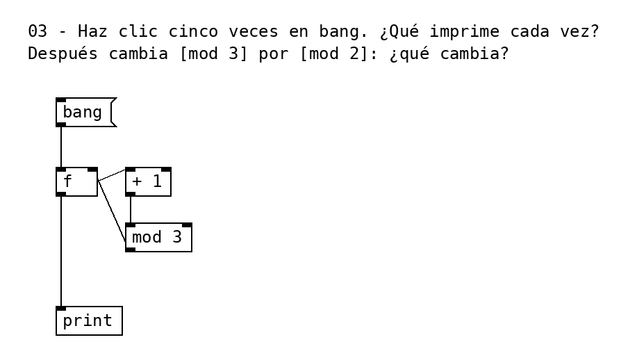

    **04 · sel**

    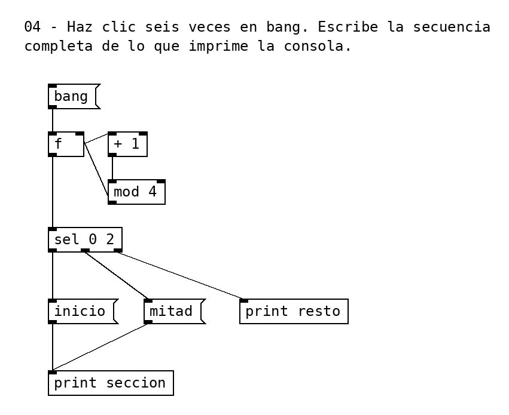

    **05 · trigger frente a fan-out**

    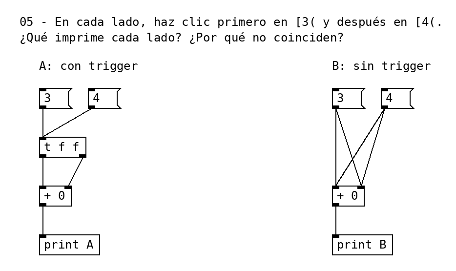

??? note "Los patches (.pd), para comprobarlo tú"
    Ábrelos y, si aún no has escrito tu predicción, no hagas clic.

    - [01 · derecha-izquierda](../patches/S1/01-derecha-izquierda.pd)
    - [02 · caliente-fría](../patches/S1/02-caliente-fria.pd)
    - [03 · contador](../patches/S1/03-contador.pd)
    - [04 · sel](../patches/S1/04-sel.pd)
    - [05 · trigger frente a fan-out](../patches/S1/05-trigger-vs-fanout.pd)

??? success "Soluciones (ábrelas después de haber predicho)"
    - **01.** 3 · 2 · 1. `[trigger]` dispara sus salidas de derecha a izquierda. Es la regla de todo Pd: los objetos también reparten de derecha a izquierda.
    - **02.** 10 · — · 15 · — · 15. La entrada derecha es fría: guarda sin disparar. La izquierda es caliente: calcula con lo guardado. El tercer clic suma 10 + 5, no 10 + 0.
    - **03.** 0 · 1 · 2 · 0 · 1. Con `[mod 2]`: 0 · 1 · 0 · 1 · 0. `[f]` saca lo que tiene guardado, y el incremento vuelve por la entrada fría: el primer clic imprime 0, no 1. El estado vive en el bucle, no en ningún objeto.
    - **04.** seccion: inicio · resto: 1 · seccion: mitad · resto: 3 · seccion: inicio · resto: 1. Un contador de 0 a 3. `[sel 0 2]` tiene tres salidas: una por argumento y la última para «lo demás», que deja pasar el número. Es la primera regla de forma: el ciclo tiene secciones.
    - **05.** A: 6 · 8. B: en este archivo, 3 · 7. En A, `[t f f]` carga primero la entrada fría y después dispara: 3 + 3, 4 + 4. En B, la misma salida va a dos entradas sin `[trigger]`, y el orden depende de en qué orden se crearon las conexiones. Si las borras y las rehaces al revés, B da 6 · 8. El patch se ve idéntico y se comporta distinto: por eso existe `[trigger]`.

## Contenidos de referencia

### Mañana: la tabla como partitura

Una tabla (`[array]`) es una lista de números con un índice. La escala que en la S1 hacíamos con `[sel]` y mensajes cabe en una tabla de siete números, y `[tabread]` la lee: más corto, y se puede cambiar sin tocar el patch. Si cada número es una nota y el índice lo da el contador de la S1, la tabla es una **partitura**: el contador avanza, la tabla responde con la nota que toca en cada paso.

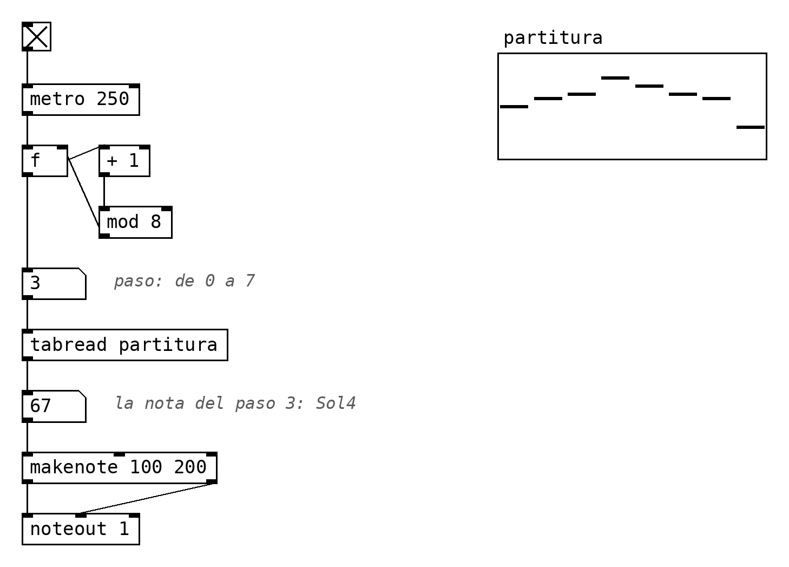{ width="729" }

La tabla es también un objeto gráfico: se escribe con el ratón, dibujando sobre ella en modo ejecución. En sus propiedades (clic derecho) decides dos cosas distintas: **en horizontal, cuántas casillas** tiene (los índices: 0, 1, 2…, siempre enteros); **en vertical, el rango** de los valores que guarda (de 48 a 72, de 0 a 1… lo que necesites).

#### Mandar sin cables

`[send nota]` (o `[s nota]`) manda lo que le llega a todos los `[receive nota]` (`[r nota]`), sin cable de por medio. **Los nombres son globales:** llegan a todos los patches abiertos, así que ponles nombres que no choquen.

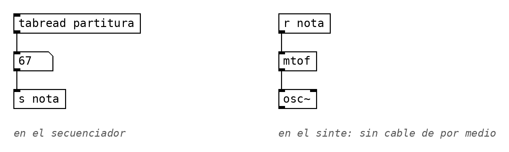{ width="762" }

Aquí la nota no va a la DAW, sino a un oscilador: `[mtof]` la convierte en frecuencia y `[osc~]` (con un `[dac~]` detrás) la hace sonar en el propio Pd. Es el primer contacto con el audio; por la tarde veremos qué hay dentro.

#### Escribir en una tabla

Dibujar es rápido, pero impreciso. Para escribir exactamente una melodía, un mensaje que empieza por punto y coma es también un *send*: manda lo que sigue al nombre que va detrás. Este escribe cuatro notas en la tabla «partitura», a partir de la casilla 0:

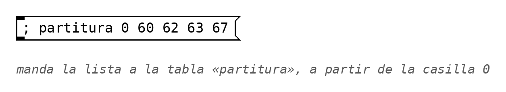{ width="628" }

#### Cuantizar las alturas

Lo que dibujas con el ratón no cae en ninguna nota: la tabla guarda 2,6 o 4,1. Para trabajar dentro de una escala, la partitura no guarda notas, sino **grados**: el contorno de la melodía (de 0 a 6), y otra tabla, la **escala**, dice a qué intervalo corresponde cada grado. Cambia la escala y cambias la interválica sin tocar el contorno.

- `[int]` se queda con la parte entera: 2,6 → grado 2.
- `[+ 0.5]` antes de `[int]` **redondea** en lugar de truncar: 2,6 → grado 3, más cerca de lo que dibujaste.

Con MIDI, la diferencia no se oye: `[noteout]` solo acepta notas enteras y trunca los decimales por su cuenta. Con el oscilador, sí: `[mtof]` acepta 62,6, y suena entre dos notas.

#### Cuánto dura una semicorchea

`[metro]` trabaja en milisegundos; la música, en pulsos por minuto. 60.000 ms / bpm = duración de una negra; dividida por 4, una semicorchea.

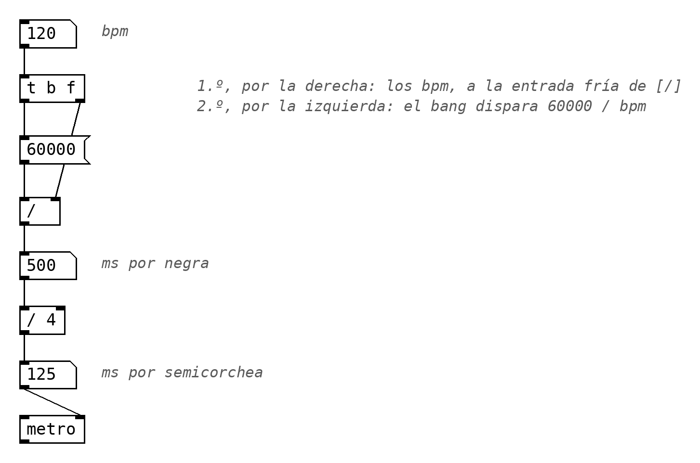{ width="726" }

Con `[mod]` y `[sel]` sobre un contador de semicorcheas sabes además en qué parte del compás estás: `[mod 4]` da la posición dentro de la negra; `[mod 16]`, dentro del compás. Y con `[sel 0]` detrás, un golpe en cada subdivisión: tras `[mod 2]`, cada corchea; tras `[mod 4]`, cada negra. Varios pulsos a la vez, desde un solo contador.

#### Cuantizar el tiempo

Lo mismo con las duraciones: una tabla no guarda milisegundos (287 ms no cae en ningún compás), sino **semicorcheas** (1, 2, 3…), que se multiplican por lo que dura una semicorchea. El resultado entra por la derecha del `[metro]`: vale desde el pulso siguiente. `[max 1]` evita una duración de cero.

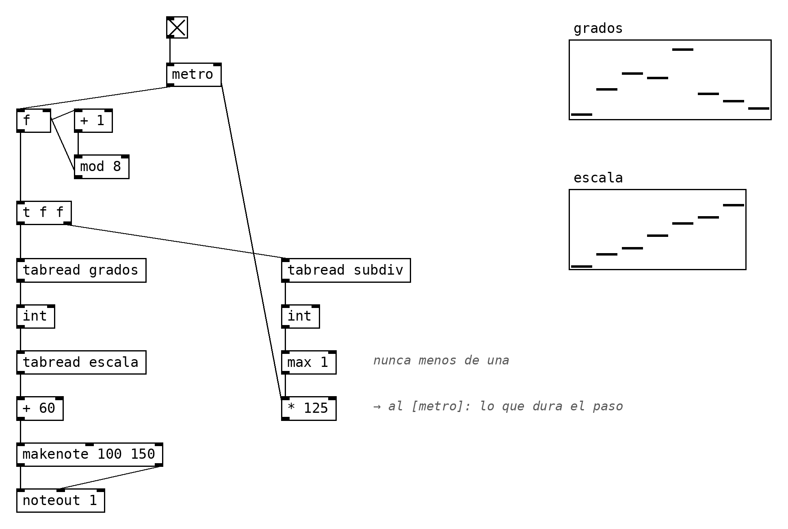{ width="970" }

#### Una técnica: la isorritmia

En este patch, alturas y duraciones comparten contador: cada grado tiene siempre la misma duración. Dales tablas de distinta longitud y un contador a cada una, y tienes la técnica del motete del siglo XIV.

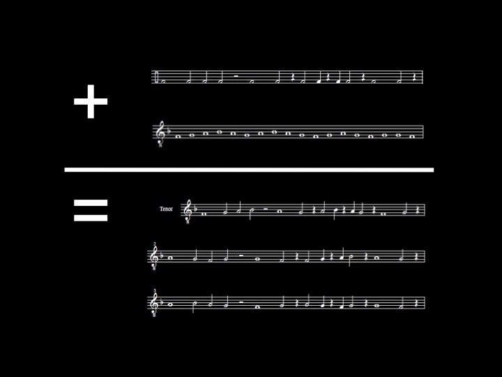

En el motete isorrítmico (Machaut, Du Fay), un patrón de alturas (*color*) y uno de duraciones (*talea*) de distinta longitud se repiten a la vez. Como no coinciden, cada vuelta combina alturas y duraciones de otra manera, hasta que vuelven a encontrarse en el punto de partida. En Pd: dos tablas de distinta longitud, leídas por dos contadores.

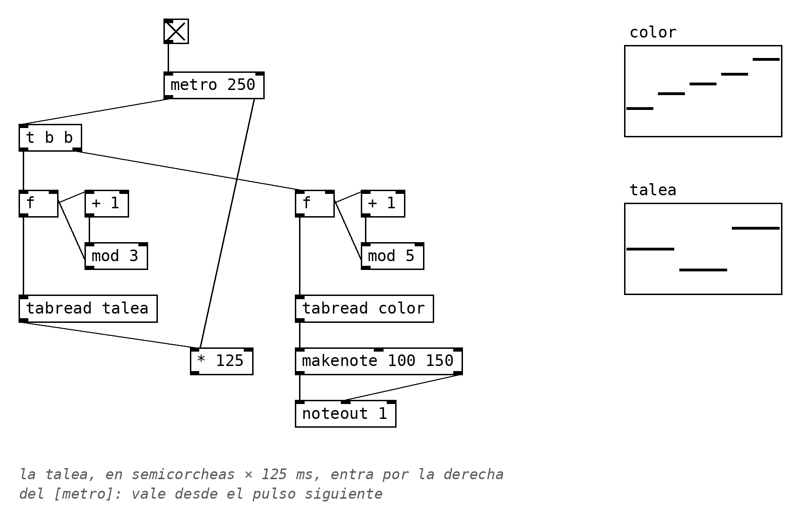{ width="862" }

!!! question "Predicción"
    Dos contadores avanzan juntos: uno con `[mod 3]`, el otro con `[mod 4]`. ¿Después de cuántos pasos vuelven a estar los dos en 0? ¿Y con `[mod 5]` y `[mod 7]`? ¿Y con `[mod 4]` y `[mod 6]`? Piénsalo antes de comprobarlo.

Hay más técnicas que salen igual de una tabla y un contador (retrogradación, acordes): al final de la página, en «Para ir más allá».

#### Tocar el secuenciador

Hasta ahora el secuenciador se ejecuta y se escucha. **Tocarlo** es cambiar, mientras suena, los números que esperan en las entradas frías.

**Los objetos gráficos.** Un *slider*, una caja de número, un *toggle*: imitan los controles del hardware de sonido y mandan números al moverlos. Como la tabla, en sus propiedades decides su rango; y también pueden mandar y recibir sin cables: en las propiedades tienen su propio *send* y *receive*.

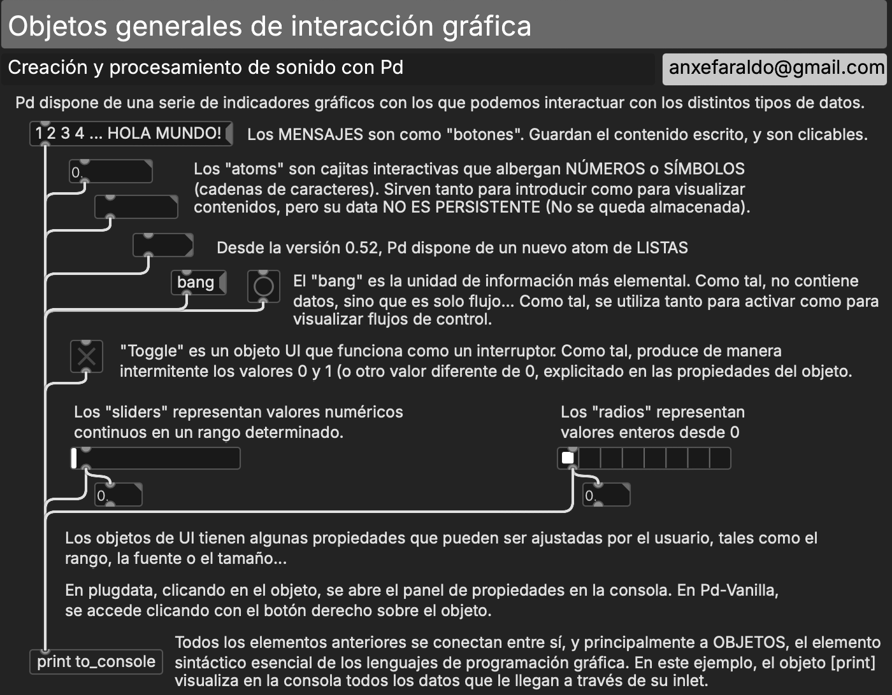{ .patch }

Dos ejes para tocar la línea isorrítmica:

- **La transposición.** Un *slider* de −12 a 12 a la entrada fría de un `[+]`, entre la escala y la salida: la melodía se transporta desde la nota siguiente.
- **El tempo.** Un *slider* para la unidad (la semicorchea), a la entrada fría del `[*]` de las duraciones: toda la línea acelera o frena sin perder sus proporciones. Para el tempo, mejor en **escala logarítmica** (*log*, en las propiedades): en lineal, la mitad del recorrido se iría en tempos que apenas se distinguen. En log, cada tramo igual del recorrido multiplica el tempo por lo mismo, que es como lo oímos. Por la tarde, este mismo *slider* nos llevará del ritmo a la altura.

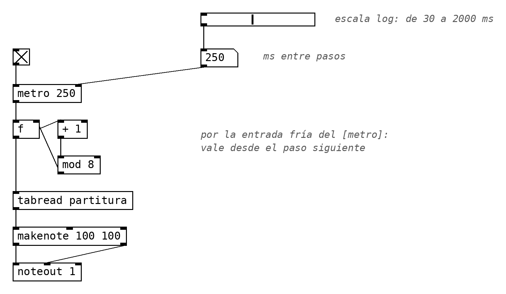{ width="737" }

Dos controles, una sola idea: un número que espera en una entrada fría y se toca mientras suena.

**Más maneras de tocar (si quieres ir más allá).**

- **Con un teclado.** `[notein]` recibe las notas de un teclado MIDI o de una pista de la DAW con plugdata dentro; `[keyboard]` de ELSE es un teclado en pantalla. Restándole 60 (`[- 60]`), la tecla da los semitonos de transposición.

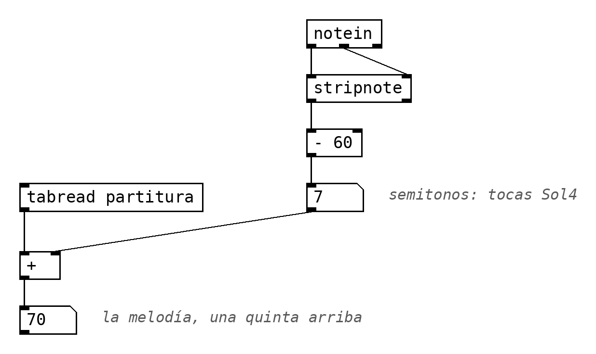{ width="618" }

- **Escribir tocando.** `[tabwrite partitura]` escribe el número que le llega por la izquierda (caliente) en la casilla que tiene en la derecha (fría). Con el contador de la S1, cada nota que tocas va a la casilla siguiente: la partitura se toca, no se teclea. Tocando escribes notas, no grados: esa tabla se lee sin pasar por la escala. `[stripnote]` deja pasar solo las teclas que se pulsan (no las que se sueltan).

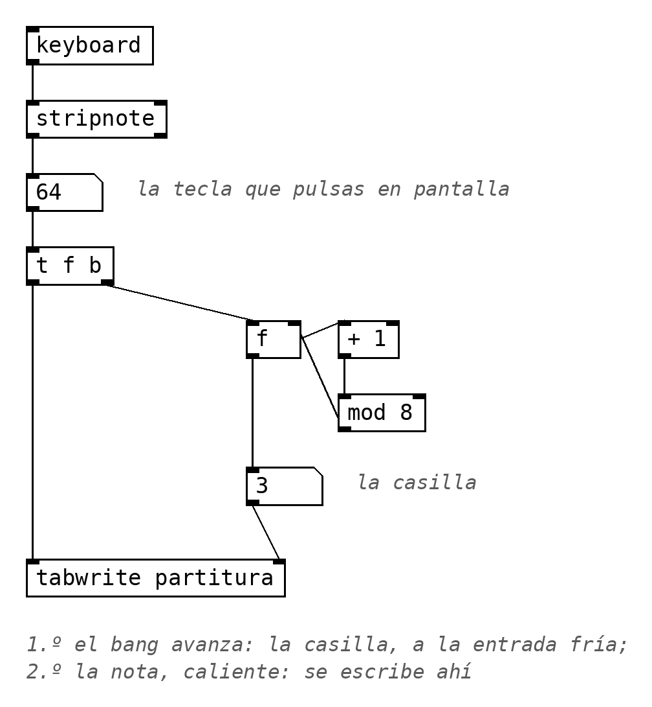{ width="504" }

### Tarde: la tabla como forma de onda

#### Para leer: Nancarrow, Cowell y el continuo

Henry Cowell propuso en *New Musical Resources* (escrito en 1919, publicado en 1930) que **ritmo y altura son el mismo fenómeno a distinta velocidad**: una proporción de tempo de 3:2 es la misma que hay entre las dos notas de una quinta. Conlon Nancarrow tomó la idea al pie de la letra. Escribió más de sesenta estudios para pianola, perforando los rollos a mano, con cánones a tempos que ningún pianista podría tocar.

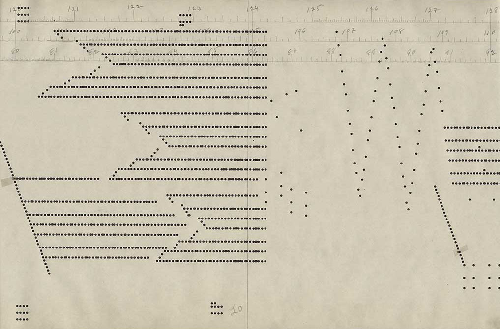

*Detalle de un rollo original del Estudio 49.*

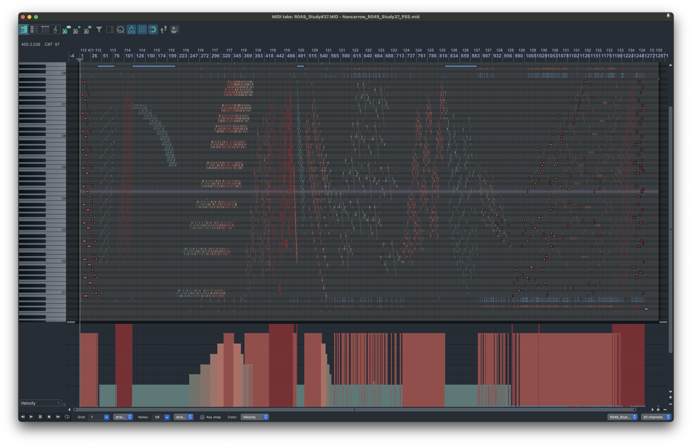

*El Estudio 37: un canon a doce voces con doce tempos distintos, en las proporciones de una escala justa. Ritmo y armonía con los mismos números. Aquí, en el piano roll de una DAW, a partir de la transcripción de la Fundación Paul Sacher.*

La idea es antigua: en la *Missa prolationum*, Ockeghem hace que varias voces lean la misma línea a velocidades distintas.

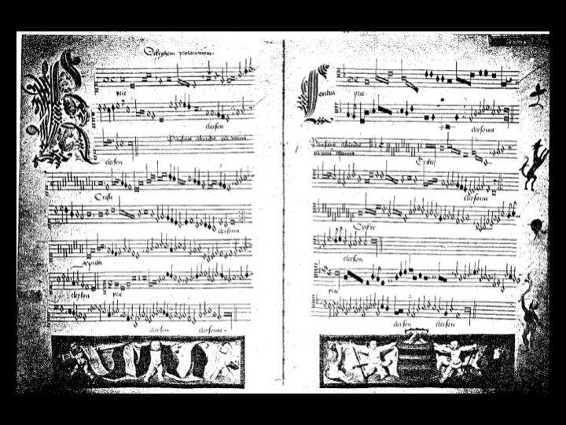

Y tiene un pie en la mañana. La isorritmia eran dos ciclos de distinta longitud sobre un mismo pulso. Con varios `[metro]` a tempos distintos, en lugar de varias tablas, tienes la polirritmia de Nancarrow: está entre los patches de la sesión (`0205b`).

#### El límite de lo simbólico

Con el *slider* de la mañana, acelera la línea: 8 notas por segundo, 16, 30… Hacia las 20 por segundo dejamos de oír notas y empezamos a oír un tono. Pero el `[metro]` no da para mucho más: necesitamos un contador más rápido.

`[phasor~]` es ese contador: una rampa que va de 0 a 1 una y otra vez, a velocidad de audio. A 2 Hz se oyen golpes; a 200 Hz, una altura. **El ritmo se ha convertido en altura.**

**Periodo y frecuencia.** `[metro]` habla en milisegundos entre golpes (el periodo); `[phasor~]`, en vueltas por segundo (la frecuencia, en Hz). Una es la inversa de la otra: Hz = 1000 / ms, y ms = 1000 / Hz. Un `[metro 50]` y un `[phasor~ 20]` laten igual: 50 ms son 20 Hz, justo el umbral.

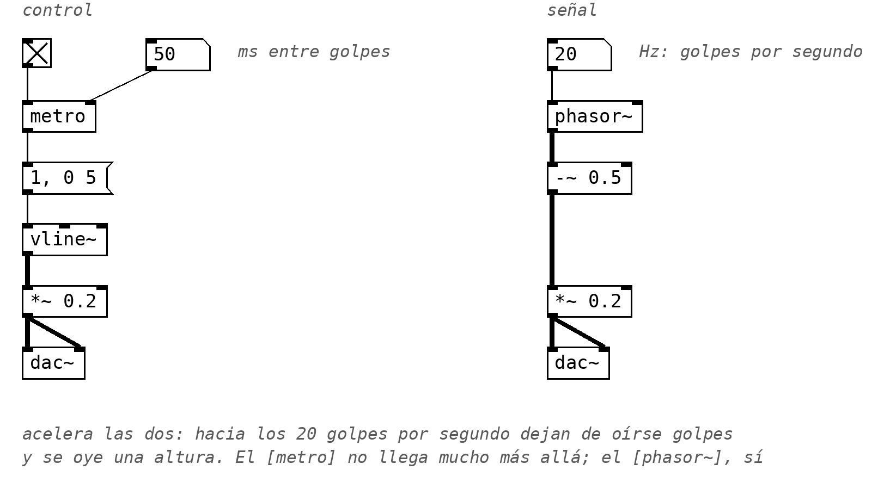{ width="812" }

#### Señal frente a control

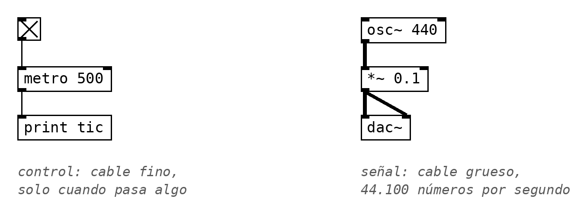{ width="678" }

La tilde (`~`) indica **señal**: un flujo continuo de números, cable grueso, que solo corre con el DSP encendido. El **control** (cable fino) solo existe cuando pasa algo. En plugdata, la señal es naranja y el control, azul.

#### Una forma de onda en una tabla

Por la mañana, un contador lento leía una partitura. Ahora, `[phasor~]` recorre una tabla cientos de veces por segundo: cada vuelta es un periodo. Las vueltas por segundo son la altura; lo que hay dibujado en la tabla, el timbre. La tabla es la misma de la mañana, con el rango de −1 a 1, y la forma de onda se dibuja con el ratón.

Lo que da `[phasor~]` es la **fase normalizada**: en qué punto de la vuelta estamos, de 0 (el principio) a 1 (el final). Multiplicada por el tamaño de la tabla, es el índice: con una tabla de 500 puntos, `[*~ 500]`. `[tabread~]` lee la casilla tal cual, a saltos; `[tabread4~]` interpola entre casillas y suena más limpio.

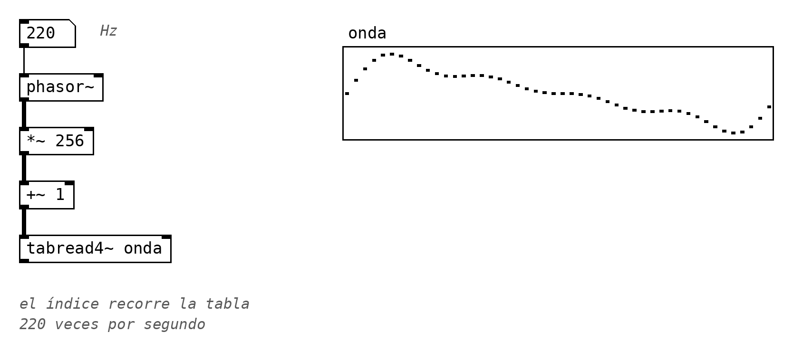{ width="834" }

`[osc~]` es exactamente esto, con una tabla de coseno que ya trae Pd.

#### El primer sinte propio

La nota llega sin cables (`[r nota]`), `[mtof]` la convierte en vueltas por segundo, y el `[phasor~]` lee la forma de onda. Lo que en la DAW hacía el sinte por ti lo construyes: `[vline~]` dibuja la envolvente (`1 5, 0 300 5`: a 1 en 5 ms; luego, a 0 en 300 ms), `[*~]` la aplica y `[dac~]` suena. Con un `[metro]` disparando el mensaje de la envolvente, cada golpe es una nota: el secuenciador de la mañana, ahora con tu propio sonido.

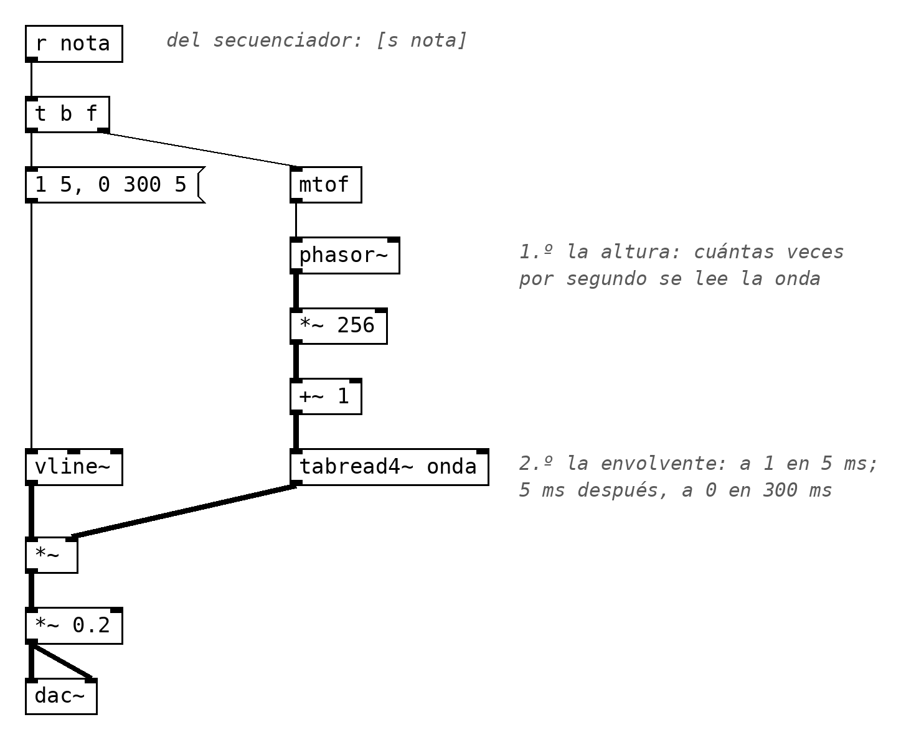{ width="724" }

!!! tip "Ten un espectrograma abierto"
    A partir de hoy, cuando algo suene, míralo además de oírlo: `[spectrograph~]` de ELSE, conectado a lo mismo que va al `[dac~]`.

#### Varias voces, una melodía: el canon de velocidades

El mismo `[phasor~]` puede leer también la partitura: recorre la melodía entera en cada vuelta. `[tabread~]` salta de casilla en casilla, así que se oyen notas. Despacio, una melodía; hacia 20 vueltas por segundo, una textura; a 200, la partitura se ha convertido en timbre.

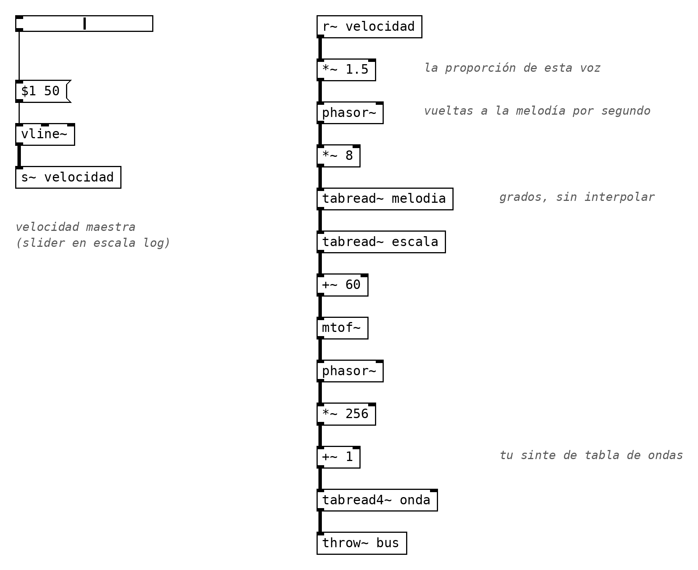{ width="920" }

Varias voces, copias del mismo patch, leen la misma melodía, cada una a su velocidad: una velocidad maestra, tocada con un *slider* en escala log, que cada voz multiplica por su proporción. Es el canon de Ockeghem y de Nancarrow:

- **Proporciones simples** (1, 3/2, 5/4): despacio, un canon de tempos; deprisa, un acorde. Lo que decía Cowell.
- **Proporciones casi iguales** (1, 1,01, 1,02): las voces se separan poco a poco hasta disolverse en una masa. Ligeti.

**El bus.** Cada voz termina en `[throw~ bus]`, y un solo `[catch~ bus]` las suma. Un volumen para todas, con `[vline~]` para que no haga clics, y bajo: cuatro voces a 1 saturan.

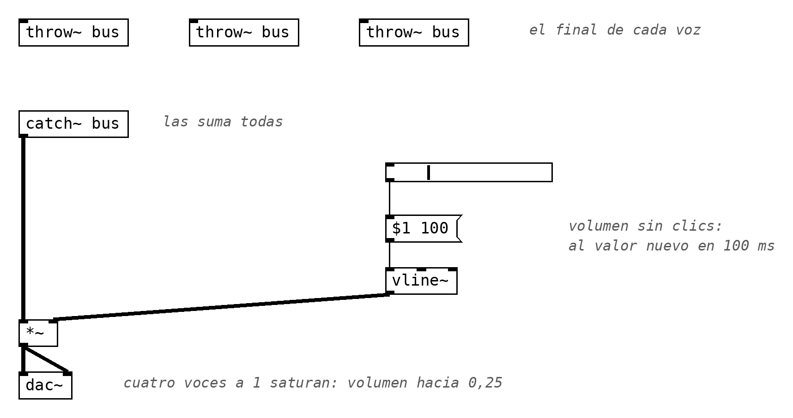{ width="858" }

Todo está en el patch `0212 Canon de velocidades`.

### Para ir más allá

Lo que sigue no se explica en clase. Está aquí, con sus patches, para quien quiera ir más allá del encargo.

#### Más técnicas

**Retrogradación.**

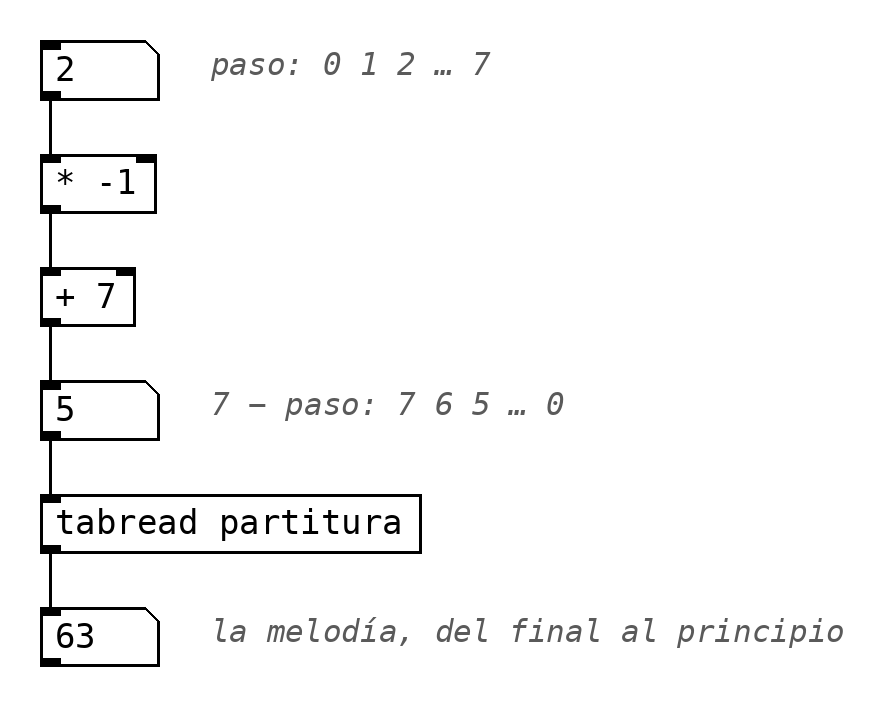{ width="442" }

La misma cuenta que la inversión de la S1 (120 − nota), aplicada al índice: 7 − paso.

**Acordes.**

La armonía como suma: la fundamental, más una tercera y una quinta, repartidas por `[t f f f]`. Con la tercera en 4, mayor; en 3, menor.

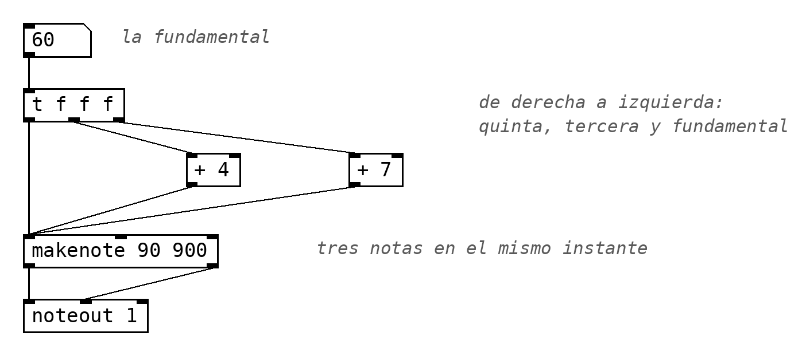{ width="706" }

Para los acordes, tu sinte necesita una copia por voz, cada una con su `[r]`. En la S6 veremos cómo no tener que copiarlas a mano.

#### Escalar un controlador

`[ctlin]` recibe los controladores (potenciómetros, automatizaciones de la DAW), que van de 0 a 127.

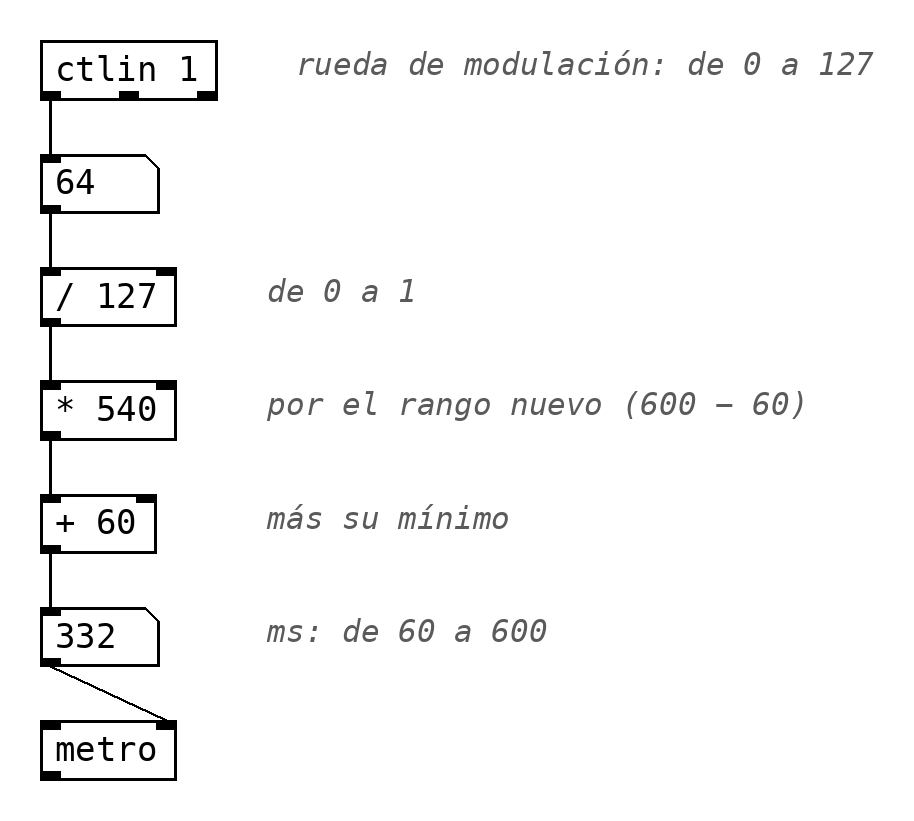{ width="457" }

Un potenciómetro manda valores de 0 a 127; el tempo necesita, por ejemplo, de 60 a 600 ms. Hay que **escalar**: restar el mínimo, dividir por el rango, multiplicar por el rango nuevo y sumar su mínimo. `[scale]` de ELSE lo hace en una caja; conviene saber qué hace dentro.

??? info "Para saber más (fuera de clase)"
    **Más objetos gráficos.** ELSE añade *knobs*, osciloscopios, vúmetros y espectrogramas.

    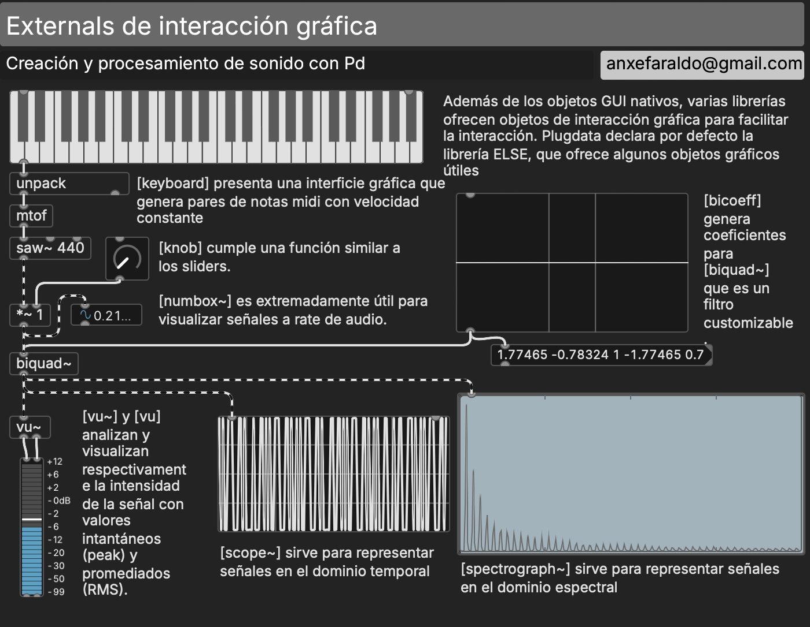{ .patch }

    `[keymap]` de ELSE convierte el teclado del ordenador en un teclado MIDI. En el *object browser* de plugdata, los generadores están en «Signal Generators» y «Random and Noise».

    **Otros mensajes MIDI.** Además de notas, MIDI transporta controladores (`[ctlout]`), cambios de programa (`[pgmout]`), *pitch bend* (`[bendout]`) y *aftertouch*.

    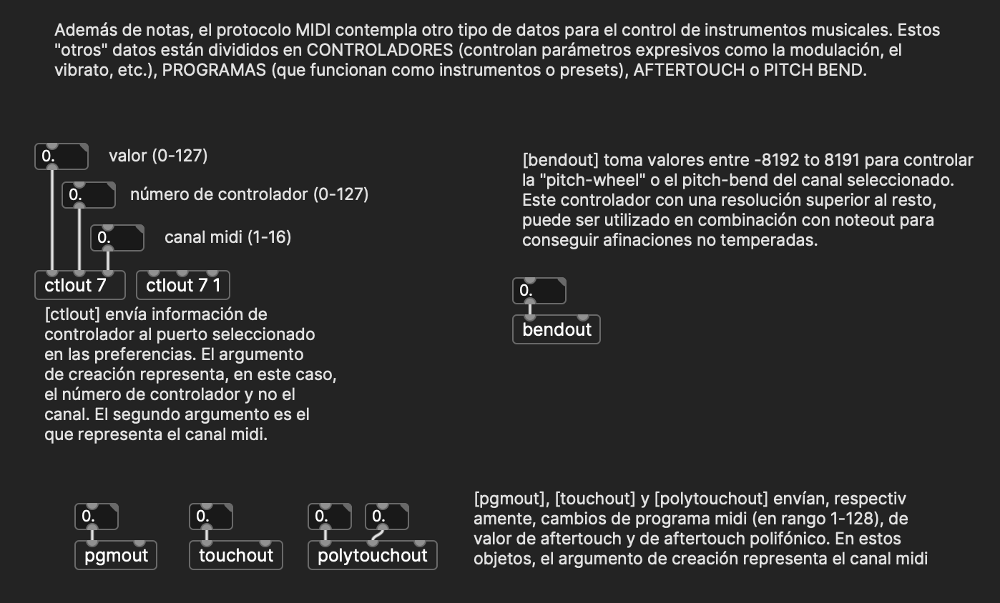{ .patch }

    **Alturas fuera del temperamento** con *pitch bend*:

    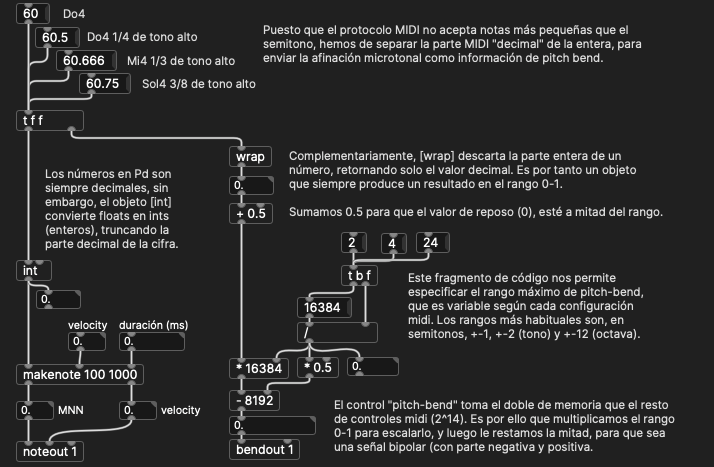{ .patch }

    **Pd escuchando a la DAW.** Como plugin, plugdata puede leer la posición del cursor y el tempo de la DAW con `[playhead]`, y exponer parámetros automatizables con `[param]`.

    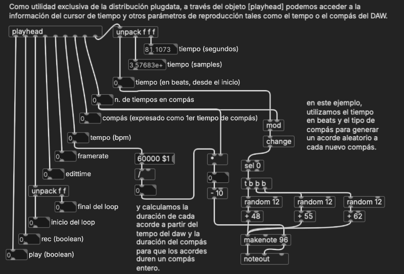{ .patch }

    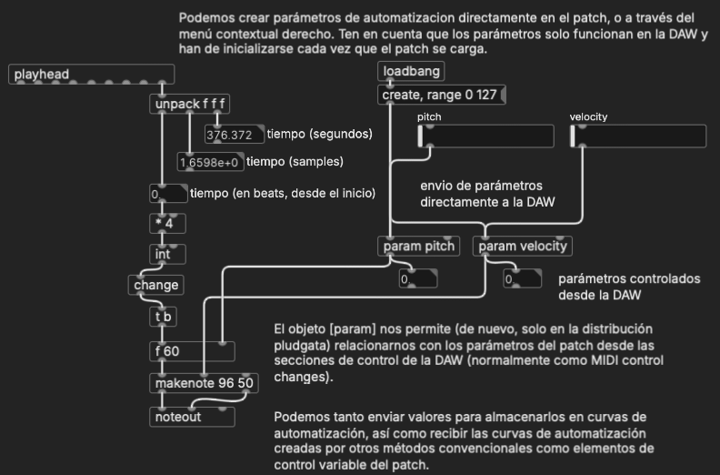{ .patch }

    **Lecturas en la red:** [Robert Willey, *Electronic Realizations of Nancarrow's Study No. 37*](http://www.willshare.com/willeyrk/creative/papers/study37/) · [Michael Connor, *The impossible music of Black MIDI*](https://rhizome.org/editorial/2013/sep/23/impossible-music-black-midi/).

## Lo esencial de hoy

| Objetos | Para qué |
|---|---|
| **Mañana** | |
| `[array]` · `[tabread]` | Una tabla: partitura, escala, duraciones. Se lee con un índice. En sus propiedades, cuántas casillas y qué rango. |
| `[send]` · `[receive]` · `; nombre …` | Mandar sin cables, de uno a muchos. Un mensaje con punto y coma también manda: así se escribe en una tabla. Los nombres son globales. |
| `[mtof]` · `[osc~]` · `[dac~]` | Oír la nota en Pd, con decimales: el primer contacto con el audio. |
| `[int]` · `[+ 0.5]` · `[max]` | Truncar o redondear; poner un mínimo. Cuantizar. |
| *slider* · número · *toggle* | Tocar el patch: mandar números al moverlos. Con su rango y su propio *send*. El del tempo, en escala log. |
| **Tarde** | |
| `[phasor~]` | Una rampa de 0 a 1: el contador, a velocidad de audio. |
| `[tabread4~]` · `[tabread~]` | Leer una tabla a velocidad de audio: interpolando (una forma de onda) o a saltos (una partitura). |
| `[mtof~]` | De nota a frecuencia, en señal. |
| `[vline~]` · `[*~]` | La envolvente y su aplicación. También, un volumen sin clics. |
| `[throw~]` · `[catch~]` | Sin cables, de muchos a uno: el bus que suma las voces. |

- **La tabla es una partitura,** y el contador de la S1, su lector.
- **La tabla guarda índices:** grados de una escala y semicorcheas. Así cualquier trazo suena en la escala y en el compás. El tempo es una división: 60.000 / bpm.
- **Una técnica es aritmética sobre el índice:** la isorritmia son dos contadores con distinto `[mod]`, que tardan en volver a coincidir.
- **Tocar el patch** es cambiar los números que esperan en las entradas frías, mientras suena: la transposición, el tempo, la velocidad.
- **Ritmo y altura son el mismo continuo** a distinta velocidad: hacia los 20 golpes por segundo, el ritmo se oye como altura.
- **Señal y control.** La señal (`~`, cable grueso) es un flujo continuo; el control solo existe cuando pasa algo.
- **La misma tabla y el mismo índice, a dos velocidades:** por la mañana, una partitura; por la tarde, una forma de onda.
- **Un canon de velocidades** es una sola melodía leída a varias proporciones: despacio, polifonía; deprisa, un acorde o una masa.

## Patches de referencia

[Descarga los patches de la sesión (zip)](../patches/peg-s2.zip). Son los patches de las capturas de esta página, para abrirlos y tocarlos: lo que no está aquí lo tienes en la documentación (ver «Para seguir por tu cuenta»). Los sonidos que usan están en [Sonidos de trabajo](../sonidos.md).

## Para seguir por tu cuenta

**Documentación de Pd**

- `2.control.examples`: 15–16 (arrays), 18 (condicionales), 19 (azar), 23 (secuencias), 24 (bucles).
- `3.audio.examples`: A01–A06 (sinusoide, amplitud, `line~`, salida, frecuencia), B01 (tablas de ondas), D01–D02 (envolventes, ADSR), C01 (Nyquist).

**Live Electronics Tutorial (Porres)**

- *Control › Sequencing*: `Array-Sequencer` (la tabla como partitura) y `Rhythmic`.
- *Control › Trigger-LFO-LFNoise › clock.metronome*: tempo, bpm y `[polymetro]` (varios pulsos a la vez: isorritmia).
- *The Basics › Pd Quickstart › Audio.DSP.Pd*: `AudioXControl-Rate` (señal frente a control).
- *The Basics › Oscillators*: `Sine-Cosine`, `Phasor`, `Frequency`.
- *Control › Lines* (`[line~]`, `[vline~]`) y *Control › Envelopes* (`Classic.Types`: AR, ADSR).
- *The Basics › Amplitude-dB* y *Gain.Adjustment*: amplitud, decibelios y volumen sin clics.

## Encargo

[E2 · Canon de velocidades](../encargos/e2.md), para el domingo 8 de noviembre.
