# S3 · Manipulación de sonido grabado

!!! note "Sesión 3 · domingo 8 de noviembre de 2026 · 11:30–14:30 y 15:30–18:00"
    **Antes de venir:** entrega [E2](../encargos/e2.md). Hoy trabajamos con los archivos de [Sonidos de trabajo](../sonidos.md); si ya tienes sonidos grabados por ti, tráelos también.

¿Se oye la lectura o se oye el material?

<ol>
<li data-src="audio/s3/el-dabh-expression-of-zaar.mp3"><b>Halim El-Dabh</b> · <i>The Expression of Zaar</i> (1944)</li>
<li data-src="audio/s3/derbyshire-doctor-who.mp3"><b>Delia Derbyshire</b> · <i>Doctor Who</i>, sintonía (1963)</li>
<li data-src="audio/s3/ellison-sonic-phantoms.mp3"><b>Barbara Ellison</b> · <i>Vocal Phantoms tts#01</i> (<i>Sonic Phantoms</i>, 2018)</li>
<li data-src="audio/s3/reich-its-gonna-rain.mp3"><b>Steve Reich</b> · <i>It's Gonna Rain</i> (1965)</li>
</ol>

[Guía de escucha →](../escuchas/s3.md){ .radio-guia }

En la S2, la tabla fue dos cosas: una partitura que se leía despacio, y una forma de onda que se leía cientos de veces por segundo. En los dos casos, la dibujábamos nosotras. Hoy la tabla contiene un **sonido grabado**. La manera de leerla es la misma de la S2, un índice que la recorre; lo que cambia es lo que hay dentro, y que ahora la velocidad de lectura decide a la vez la duración y la altura. Por la mañana construimos un lector; por la tarde, lo convertimos en un instrumento que se toca con el teclado: un *sampler*.

## Plan de la sesión

**Mañana**

1. Para empezar, una escucha: Walter Ruttmann, *Wochenende* (1930).
2. Defensa de encargos (E2).
3. Reconstrucción, sin apuntes: el sinte de tabla de ondas de la S2. Y una pregunta: ¿qué pasa si en esa tabla, en lugar de 500 puntos dibujados, cargamos un sonido de dos segundos?
4. El sonido es una tabla: cargarlo con `[sfload]` (y elegirlo con `[openpanel]`: las variables `$1` en los mensajes), oírlo tal cual con `[tabplay~]`, y leerlo nosotras con `[phasor~]` y `[tabread4~]`. Velocidad, dirección y transposición: una sola cuenta.
5. Taller: cada una construye su lector, con un sonido de [Sonidos de trabajo](../sonidos.md) o con uno suyo.

**Tarde**

1. Escucha: Delia Derbyshire, *Doctor Who* · Steve Reich, *It's Gonna Rain*. ¿Se oye la lectura o se oye el material?
2. Las manipulaciones concretas, a mano en la DAW: cortar el ataque, darle la vuelta, cambiar la velocidad, el bucle. Cada una, una operación sobre el índice.
3. Del lector al *sampler*: leer una sola vez con `[vline~]`; el teclado del ordenador como instrumento (`[keymap]`, `[keyboard]`); cada tecla, un fragmento; envolventes para que no haya clics. Si hay tiempo: una envolvente ADSR y los modos de un *sampler*.
4. Escucha de algunos lectores y presentación del [E3](../encargos/e3.md).

## Para empezar: *Wochenende*

En 1930, el cineasta Walter Ruttmann (*Berlín, sinfonía de una gran ciudad*, 1927) hizo una película sin imágenes: grabó en la banda sonora de la película, la pista óptica, un fin de semana en Berlín —el trabajo que acaba, el tren, las voces, la iglesia, el campo, la vuelta— y la montó como se montaba la imagen, a cortes. Se emitió por la radio. Son unos once minutos de sonido grabado, cortado y pegado, dieciocho años antes de la música concreta. ¿Qué oyes cuando no hay nada que ver?

## Reconstrucción: el sinte de tabla de ondas

De memoria, el sinte de la tarde de la S2: `[phasor~]` da la fase, de 0 a 1; multiplicada por el tamaño de la tabla, es el índice; `[tabread4~]` lee lo que hay en ese punto. Cada vuelta del `[phasor~]` es un periodo de la onda.

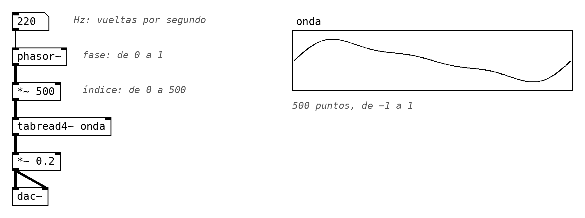{ width="948" }

Ahora, en lugar de una tabla de 500 puntos dibujados, cargamos en ella un sonido de dos segundos. Son 96.000 puntos. La cadena es la misma; solo cambian dos números.

!!! question "Predicción"
    Un sonido de 2 segundos, grabado a 48.000 Hz, cargado en una tabla y leído por un `[phasor~]` con `[*~ 96000]`. ¿A qué frecuencia tiene que ir el `[phasor~]` para que suene tal cual? ¿Qué oyes a 1 Hz? ¿Y a −0,5 Hz? ¿Y a 100 Hz?

## Contenidos de referencia

### Mañana: el sonido es una tabla

#### Un sonido son números

Un sonido digital es una lista de números entre −1 y 1: la posición de la membrana del altavoz, medida muchas veces por segundo. Cada número es una **muestra**. Cuántas por segundo lo dice la **frecuencia de muestreo** (*SR*, de *sample rate*): 48.000 o 44.100 Hz. De ahí sale la cuenta de todo lo que viene:

- **N**, el número de muestras: el tamaño de la tabla.
- **Duración** = N / SR. 96.000 muestras a 48.000 Hz son 2 segundos.

Es el mismo `[array]` de la S2. Solo que ahora no lo dibujamos: lo llenamos con un archivo.

!!! warning "Tamaño y rango: dos cosas distintas"
    Toda tabla tiene dos dimensiones, y las dos están en sus propiedades (clic derecho), no a la vista:

    - **El tamaño** (horizontal, *x*): cuántos puntos tiene. Decide los índices, siempre enteros, de 0 a tamaño − 1. En la partitura de la S2, 8; en la forma de onda, 500; en un sonido de 2 s, 96.000. `[sfload]` lo ajusta solo al cargar.
    - **El rango** (vertical, *y*): entre qué valores se dibuja. Para una partitura, de 48 a 72; para un sonido, de −1 a 1. Lo eliges tú.

    El rango no cambia los números que hay dentro, pero sí lo que ves y lo que dibujas con el ratón. Si una tabla con un sonido tiene el rango de 48 a 72, el sonido está ahí, pero no ves nada. Cuando una tabla «está vacía», mira primero el rango.

#### Cargar un sonido

En vanilla, `[soundfiler]` carga WAV y AIFF. En clase usamos `[sfload]` de ELSE, que carga cualquier formato (mp3, flac, ogg…) en un `[array]` y lo ajusta al tamaño del archivo. Al terminar, saca una lista con lo que necesitamos saber: el tamaño (N), la frecuencia de muestreo del archivo, los canales y los bits.

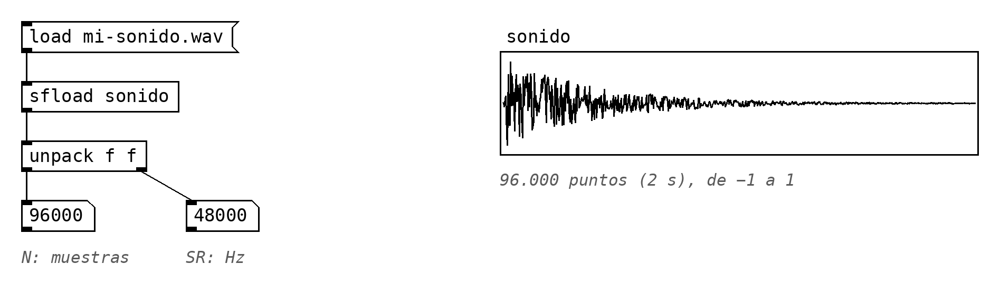{ width="948" }

Cargar, elegir el archivo y oírlo con `[tabplay~]`: patch `0301`.

#### Elegir el archivo: `[openpanel]` y las variables

Escribir el nombre del archivo en el mensaje sirve para uno. Para cambiar de sonido sin tocar el patch, `[openpanel]` abre la ventana del sistema para elegir un archivo y saca su ruta (`/Users/…/voz.wav`). Esa ruta tiene que acabar dentro del mensaje `load …`: es lo que hace `$1`.

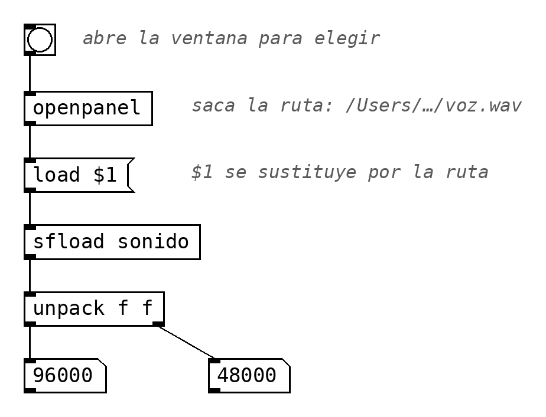{ width="462" }

**Un mensaje con `$1` es una plantilla.** Cuando le llega algo, `$1` se sustituye por el primer elemento de lo que llega, `$2` por el segundo, y así. En la S2, `[pack f 100]` juntaba un valor y un tiempo para `[vline~]`; un mensaje con `$1` hace lo mismo, y puede llevar texto, comas y varios números. Hoy aparece en casi todas las figuras: `2 $1` para los semitonos, `$1, $2 $3` para los fragmentos, `1 5, 0 5 $1` contra los clics. Si haces clic en un mensaje con `$1`, no hay nada que sustituir: se dispara desde arriba, no con el ratón.

En una caja de objeto, `$1` significa otra cosa: no es lo que llega, sino el argumento con el que se crea. Tiene sentido cuando hagamos nuestros propios objetos (abstracciones), en la S6.

El patch `0302 Generacion de sonido` pone las dos maneras una al lado de la otra: `[pack 0 100]` y el mensaje `$1 100` hacen lo mismo.

Apunta esos dos números, N y SR: los vas a usar en todas las cuentas de hoy. Usa la SR del archivo, la que da `[sfload]`, no la de Pd: si no coinciden, la cuenta con la del archivo es la que suena a su altura original.

#### Oírlo tal cual: `[tabplay~]`

Para comprobar que se ha cargado, `[tabplay~]` reproduce la tabla de principio a fin con un `bang`. También acepta comienzo y duración en muestras, y `stop`. Cuando acaba, manda un `bang` por la derecha.

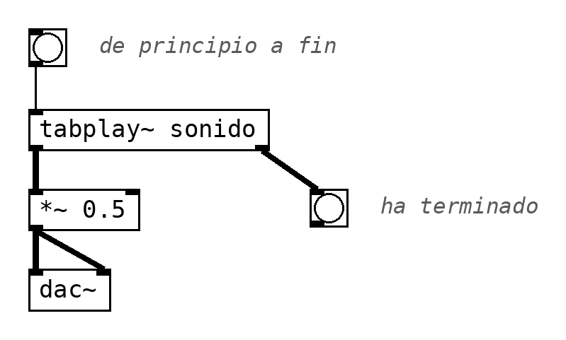{ width="400" }

Y ya está: no hay más que hacer con él. `[tabplay~]` lee siempre a la velocidad original y hacia delante. Para que la lectura componga, la hacemos nosotras.

#### En bucle: `[phasor~]`

Es la cadena de la reconstrucción, con el sonido en la tabla. El índice va de 0 a N: `[*~ 96000]`. Y para que el sonido suene tal cual, el `[phasor~]` tiene que dar una vuelta en lo que dura el sonido: si dura 2 segundos, media vuelta por segundo. **Frecuencia original = SR / N.**

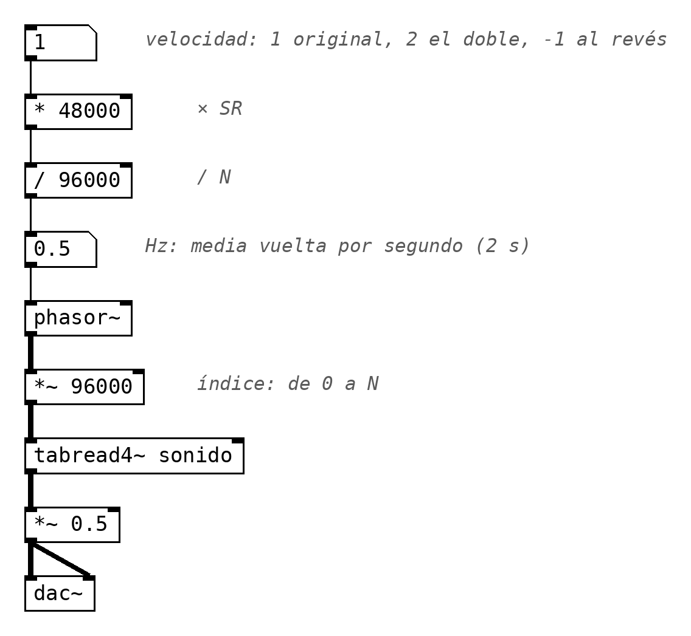{ width="568" }

`[phasor~]` vuelve a empezar al llegar al final: el sonido se repite en **bucle**, sin fin.

Patch `0303`.

#### Velocidad, dirección y altura

A partir de aquí, todo es una sola variable: la **velocidad**. Con 1, el sonido tal cual; con 2, el doble de rápido; con 0,5, a la mitad; con −1, hacia atrás. La frecuencia del `[phasor~]` es **velocidad × SR / N**.

- **El doble de rápido suena una octava arriba y dura la mitad.** Velocidad y altura van juntas, como en una cinta o en un disco: no se puede cambiar una sin la otra (separarlas es cosa de la granulación, en la S7).
- **Una velocidad negativa lee hacia atrás.** `[phasor~]` con frecuencia negativa baja de 1 a 0.
- **Muy deprisa, el bucle se convierte en altura.** Es el continuo de la S2: a 100 vueltas por segundo ya no oyes tu sonido, sino una nota de 100 Hz cuyo timbre es tu sonido entero, comprimido en una vuelta.

Patch `0304`.

#### Transportar en semitonos

Una octava es multiplicar la velocidad por 2. En el temperamento igual, la octava se divide en doce semitonos iguales, así que un semitono es el número que, multiplicado doce veces por sí mismo, da 2: la raíz duodécima de 2. Para *n* semitonos:

**velocidad = 2^(n/12)**

Cinco semitonos arriba (una cuarta), 2^(5/12) ≈ 1,335; doce abajo, 2^(−12/12) = 0,5. En Pd, `[pow]` eleva lo que le llega por la izquierda a lo que tiene en la derecha: con el mensaje `2 $1`, las dos cosas le llegan a la vez.

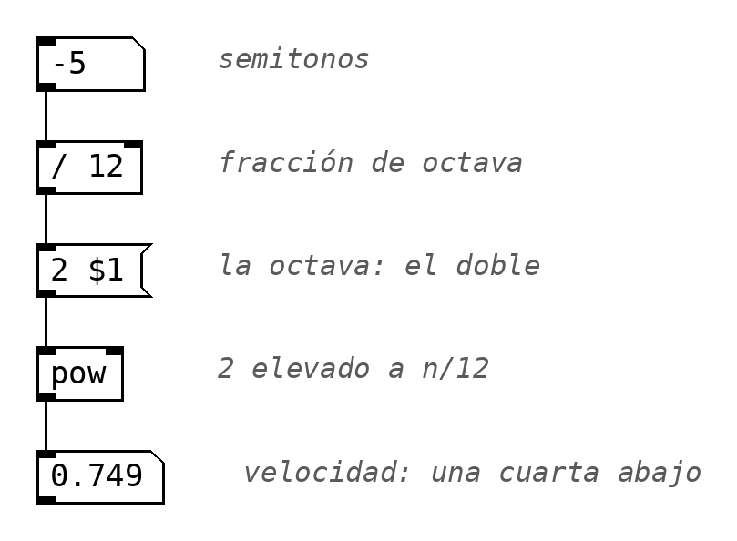{ width="404" }

Es la misma cuenta que hace `[mtof]` por dentro.

Patches `0305` (transposición) y `0306` (notas y semitonos: la cuenta de `[mtof]`, a mano).

### Tarde: del lector al *sampler*

#### Las líneas del *sampling*

> «El objeto sonoro no debe confundirse con el cuerpo sonoro que lo produce.»
> — Pierre Schaeffer

Grabar un sonido y volver a escucharlo, separado de lo que lo produjo, abre muchos caminos. En unos, lo que cuenta es el material: lo que dice, de dónde viene, de quién es. En otros, lo que cuenta es la lectura: cómo se recorre, a qué velocidad, cuántas veces.

**Lo concreto.** 1930 · Walter Ruttmann, *Wochenende* · 1944 · Halim El-Dabh, *The Expression of Zaar*, en El Cairo, con una grabadora de cable · 1948 · Pierre Schaeffer, *Cinq études de bruits* · 1951 · Groupe de Recherche de Musique Concrète, con Pierre Henry · 1958 · Groupe de Recherches Musicales (GRM); Varèse, Le Corbusier y Xenakis, Pabellón Philips · 1966 · Schaeffer, *Traité des objets musicaux* · 1974 · François Bayle, Acousmonium, la orquesta de altavoces.

*Pabellón Philips (1958): arquitectura de Xenakis y Le Corbusier, «Poème électronique» de Varèse y «Concret PH» de Xenakis.*

**La grabación como lugar.** El sonido no se separa de su fuente: es un documento de un sitio y un momento. El-Dabh ya va por ahí, y lo siguen Luc Ferrari, *Presque rien n.º 1* (1970), un amanecer en un pueblo de pescadores casi sin manipular, y Hildegard Westerkamp, *Kits Beach Soundwalk* (1989), donde la propia compositora habla sobre su grabación. Es la línea del paisaje sonoro.

**La palabra y el significado.** Luciano Berio, *Thema (Omaggio a Joyce)* (1958): la voz de Cathy Berberian leyendo a Joyce, de la palabra al sonido y de vuelta. Alberto Bernal, *G8* (2007): los himnos nacionales del G8, leídos a cámara lenta y saturados sobre sí mismos hasta neutralizar su energía patriótica. Y Barbara Ellison, *Sonic Phantoms* (2018), en la radio de hoy: voces sintéticas fragmentadas y repetidas hasta que el oído oye palabras que no están. El significado ya no está en el material, sino en quien escucha. Aquí el material importa porque significa algo, o porque parece que significa.

**La cita.** James Tenney, *Collage #1 «Blue Suede»* (1961), sobre la versión de Elvis · John Oswald, *Plunderphonics* (1985): música hecha solo con grabaciones reconocibles de otras, que pregunta qué es original y de quién es un sonido. Su disco *Plunderphonic* (1989) acabó retirado y destruido por presiones de la industria discográfica.

**El *sampler* popular.** La palabra *sampler* viene de aquí: del Fairlight CMI (1979) y la Akai MPC (1988), y del hip-hop, que construyó un género entero sobre fragmentos de discos ajenos, tocados con los dedos en unos pads. J Dilla, *Donuts* (2006): bucles de soul cortados y desplazados a mano, fuera de la rejilla. Y el *turntablism*: el tocadiscos como instrumento.

#### Las manipulaciones concretas

Antes de programarlas, las hacemos a mano, en la DAW, con uno de vuestros sonidos. Son las operaciones de la cinta, y cada una tiene su equivalente en Pd:

| En la cinta (o en la DAW) | Qué se oye | En Pd, hoy |
|---|---|---|
| **Cortar el ataque** (la *cloche coupée* de Schaeffer: una campana sin su golpe) | El sonido pierde su causa: sin el ataque, ya no reconocemos qué lo produjo | Un comienzo después del ataque |
| **Darle la vuelta** (*reverse*) | La resonancia llega antes que el golpe | Velocidad negativa, o fin menor que comienzo |
| **Cambiar la velocidad** | Altura y duración, juntas | La velocidad: 2, 0,5, 2^(n/12) |
| **Hacer un bucle** (el *sillon fermé*, el surco cerrado del disco) | Repetido, el fragmento deja de significar y se vuelve ritmo o timbre | `[phasor~]` |
| **Cortar y empalmar** | Un montaje: otro orden, otro discurso | Cada tecla, un fragmento |
| **Superponer** | Capas, polifonía | El E3, por capas |

#### Para escuchar: la lectura

Con un magnetófono, las herramientas eran las de hoy: cambiar la velocidad, darle la vuelta a la cinta, hacer bucles, cortar y pegar. Hoy escuchamos la línea de la lectura, y es una elección pedagógica: son obras que se oyen como operaciones de programación, y cada una se puede reconstruir en Pd con lo que vemos hoy. Las demás líneas son igual de importantes, pero su interés no está en cómo se lee la tabla.

- **Delia Derbyshire**, *Doctor Who* (1963). Una cuerda pulsada, grabada y copiada a distintas velocidades: cada velocidad es una nota, y con ellas se monta la línea de bajo. Es un *sampler* antes de que existieran los *samplers*: lo que haremos esta tarde.
- **Steve Reich**, *It's Gonna Rain* (1965). Dos magnetófonos tocan el mismo bucle a una velocidad casi igual, y se van desfasando. El material es una frase; la música es la lectura. En Pd: dos `[phasor~]` a frecuencias casi iguales sobre la misma tabla (patch `0307`).

#### Leer una vez: `[vline~]`

`[phasor~]` lee en bucle. Para leer una vez, del comienzo al final, y parar, usamos `[vline~]`, la de las envolventes de la S2. El mensaje `0, 96000 2000` dice dos cosas seguidas: salta a 0 y, desde ahí, ve hasta 96000 en 2000 ms. Esa rampa es el índice: ya va en muestras, no hace falta multiplicarla. Patch `0308`.

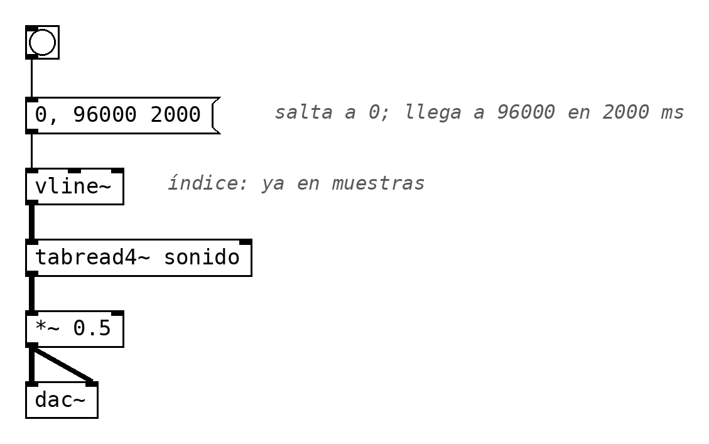{ width="564" }

!!! question "Predicción"
    El mismo sonido de 2 segundos. ¿Qué oyes con `0, 96000 1000`? ¿Y con `96000, 0 2000`? ¿Y con `48000, 48000 1000`?

#### Dos maneras de contar lo mismo

`[phasor~]` y `[vline~]` hacen lo mismo: una rampa que hace de índice. Cambia cómo se le dice la velocidad.

| | `[phasor~]` | `[vline~]` |
|---|---|---|
| Lee | en bucle | una vez |
| Habla en | frecuencia (ciclos por segundo, Hz) | tiempo (ms que tarda en llegar) |
| Su rampa va | de 0 a 1 (hay que multiplicar por N) | de donde le digas a donde le digas (en muestras) |
| Tal cual | SR / N | N / SR × 1000 |
| Con velocidad | × velocidad | / velocidad |

Es lo de la S2: frecuencia y periodo son inversos. Si piensas siempre en **velocidad** (1, 2, −1, 2^(n/12)), la única operación es multiplicar o dividir por ella.

#### El teclado como instrumento

`[keymap]` de ELSE convierte el teclado del ordenador en un teclado MIDI: la fila de la `z` es la octava de Do3 (nota 48), la de la `q`, la de Do4 (60). Cada tecla manda una lista `nota velocidad`: 127 al pulsarla, 0 al soltarla. `[keyboard]`, también de ELSE, es un teclado en pantalla: muestra lo que tocas y también se toca con el ratón. Ninguno de los dos funciona en modo edición.

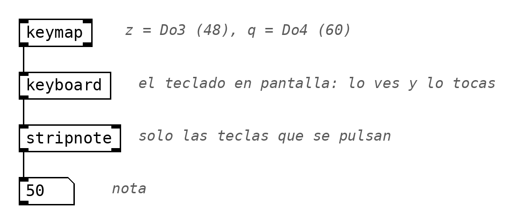{ width="550" }

`[stripnote]` deja pasar solo las teclas que se pulsan, no las que se sueltan: para disparar algo, basta con una nota.

#### Cada tecla, un fragmento

Restando 48, la `z` da 0, la `s` 1, la `x` 2… Con `[sel]`, cada tecla elige un mensaje con tres números: **comienzo, fin y duración**. El mensaje `$1, $2 $3` los coloca en su sitio para `[vline~]`.

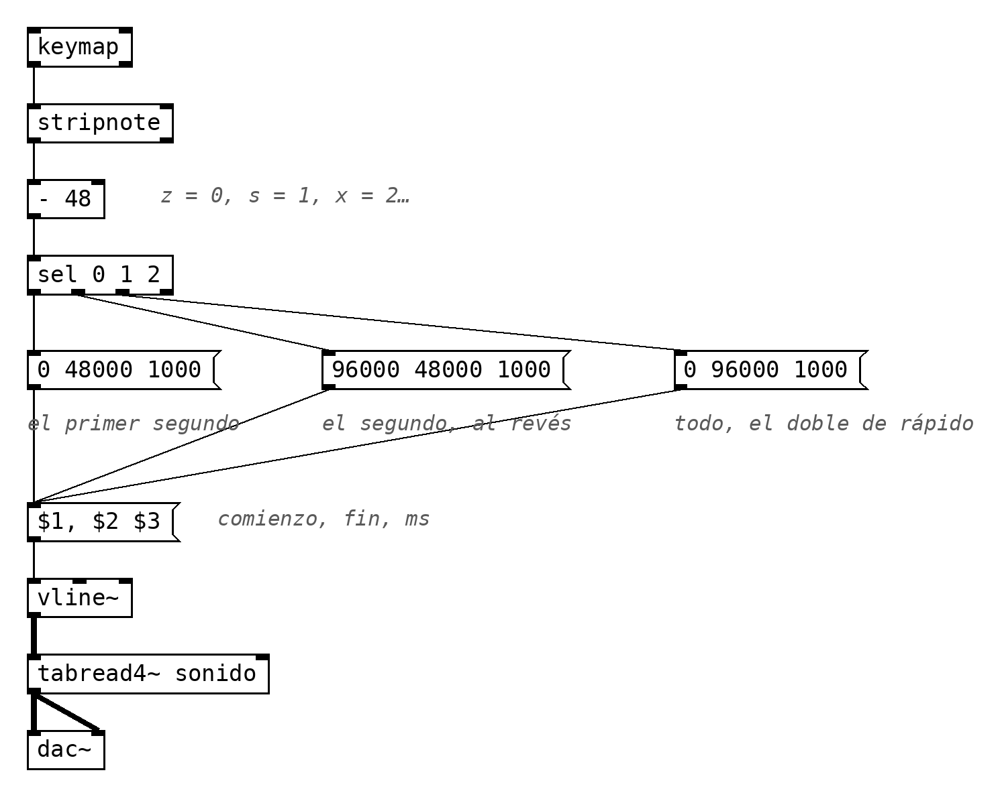{ width="745" }

Con tres números se decide todo:

- **Qué parte:** comienzo y fin, en muestras.
- **Hacia dónde:** si el fin es menor que el comienzo, hacia atrás.
- **A qué velocidad:** la duración. El fragmento dura (fin − comienzo) / SR × 1000 ms a velocidad original; si le das la mitad, suena el doble de rápido.

Si en lugar de mensajes escritos a mano quieres más teclas, es la tabla de la S2: tres tablas (comienzos, fines, duraciones) leídas con la tecla como índice. O la idea de Derbyshire: un solo fragmento y la tecla como transposición, con la velocidad 2^((nota − 60)/12). O al revés: un solo sonido largo y cada tecla como un punto de lectura distinto. O una tabla distinta por tecla: cada sonido, cargado en su tabla con su `[sfload]`, y el mensaje `set nombre` le dice a `[tabread4~]` qué tabla leer. Qué significa una tecla lo decides tú: en el [E3](../encargos/e3.md) hay más ideas.

!!! info "Mensajes con nombre: los selectores"
    Un objeto no solo entiende números. Muchos entienden también mensajes que empiezan por una palabra: `load` (`[sfload]`), `stop` (`[tabplay~]`), `set` (`[tabread4~]`). Esa primera palabra es un **selector**: una palabra asociada a una función concreta de ese objeto. El selector dice qué hacer, y lo que lo sigue, con qué. En otros lenguajes de programación, esas funciones se llaman **métodos**: cosas que un objeto sabe hacer cuando se lo pides por su nombre. Cada objeto tiene los suyos, y no se adivinan: están en su ayuda (clic derecho → Ayuda). Cuando un objeto te parezca que se queda corto, mira su ayuda antes de construir otra cosa. Los métodos de las tablas están en el patch `0309`, y un repaso de todos los objetos que leen y escriben tablas, en el `0310`.

#### Sin clics

Si el fragmento empieza o acaba en una muestra que no es 0, el altavoz salta de golpe: un clic. La solución es una envolvente muy corta en cada extremo: una segunda `[vline~]` que multiplica el sonido. Sube a 1 en 5 ms al empezar y baja a 0 en 5 ms justo antes del final: el tercer número del mensaje, el retardo, es la duración menos 5.

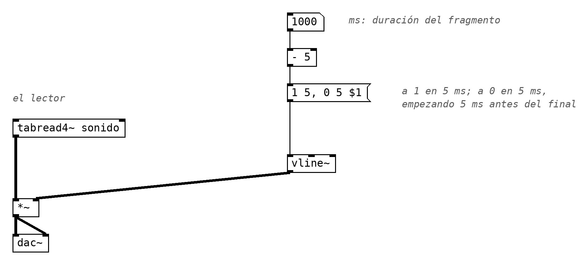{ width="942" }

Las dos `[vline~]` se disparan con la misma tecla: una mueve el índice, la otra la amplitud. El *sampler* completo, con el teclado, los fragmentos y la envolvente: patch `0311`.

#### Una envolvente que se toca: `[adsr~]`

Hasta aquí, la tecla dispara y el fragmento suena entero. Con `[adsr~]` de ELSE, la tecla abre y cierra: al pulsarla, sube (*attack*), cae a un nivel (*decay*) y se queda ahí (*sustain*) mientras la mantienes; al soltarla, se apaga (*release*). Por eso aquí no usamos `[stripnote]`: necesitamos también el 0 de soltar la tecla. La velocidad (127) entra como nivel: 127 es 1.

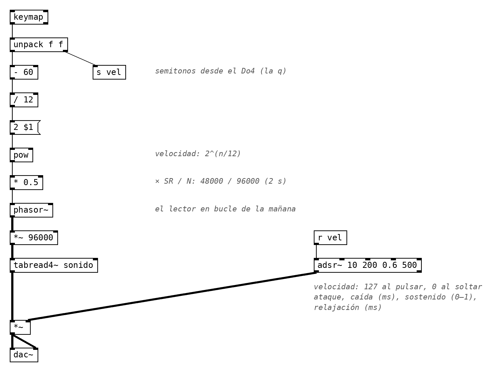{ width="1009" }

Con el lector en bucle de la mañana, es un instrumento que suena lo que dure la tecla. Patch `0312`.

#### Modos de un *sampler*

- **Un disparo** (*one shot*): la tecla dispara el fragmento y suena hasta el final, la sueltes o no. `[vline~]`.
- **Bucle**: el fragmento se repite mientras suena la nota. `[phasor~]` con comienzo y fin: índice = comienzo + fase × (fin − comienzo), y la frecuencia, velocidad × SR / (fin − comienzo).
- **Bucle sostenido**: el ataque suena una vez, desde el principio; mientras mantienes la tecla, se repite un fragmento interior (el bucle); al soltarla, se lee lo que queda hasta el final. Es como funcionan los *samplers* de instrumentos: el ataque de una nota de violín no se repite, el sonido sostenido sí. Construirlo es bastante más complejo, y no lo veremos en clase.

### Para ir más allá

#### Por qué `[tabread4~]`: la interpolación

Leyendo a una velocidad que no es 1, el índice cae entre dos muestras: 1.250,4. `[tabread~]` se queda con la de al lado, y suena áspero. `[tabread4~]` **interpola**: calcula un valor intermedio a partir de cuatro muestras, una antes y dos después del punto que lee. Por eso, en sentido estricto, el índice no debería ir de 0 a N, sino de 1 a N − 2: se multiplica la fase por N − 3 y se le suma 1. En la práctica, con sonidos que empiezan y acaban en silencio no se oye, pero si un bucle hace un ruido raro justo al dar la vuelta, es esto.

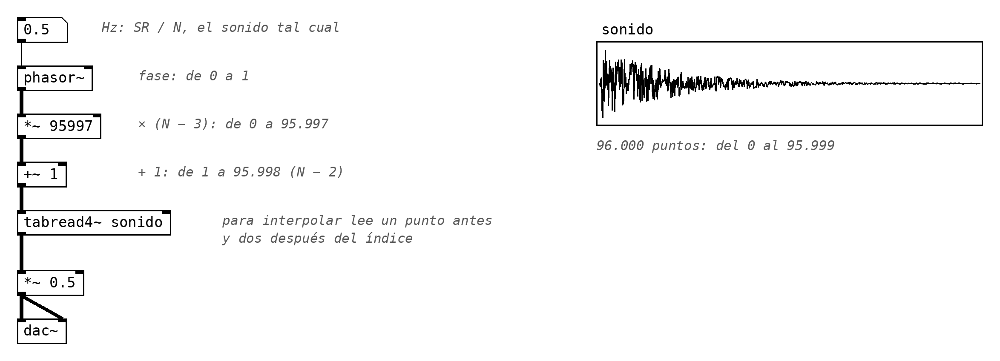{ width="1174" }

#### Troceado: leer a saltos

Con lo de hoy se puede romper el orden del sonido. Divídelo en partes iguales (16, por ejemplo). Un `[phasor~]` lee solo lo que dura una parte, y un `[metro]` con esa misma duración elige al final de cada vuelta una parte al azar con `[random 16]`. Su comienzo se suma al índice con `[+~]`, antes de `[tabread4~]`. El sonido se recompone en otro orden, como un montaje automático. Cuanto más cortas las partes, menos se reconoce el original: en la S7, acortándolas hasta unos milisegundos, llegaremos al grano. Patch `0313`.

#### Leer desde el disco

Cargar en una tabla tiene un límite: la memoria. Para sonidos largos (minutos, horas), `[readsf~]` lee directamente del disco, sin cargar nada, a la velocidad original y hacia delante. En ELSE, `[play.file~]` hace lo mismo con cualquier formato. Los usaremos en la S5 como fuentes para procesar. Patch `0314`.

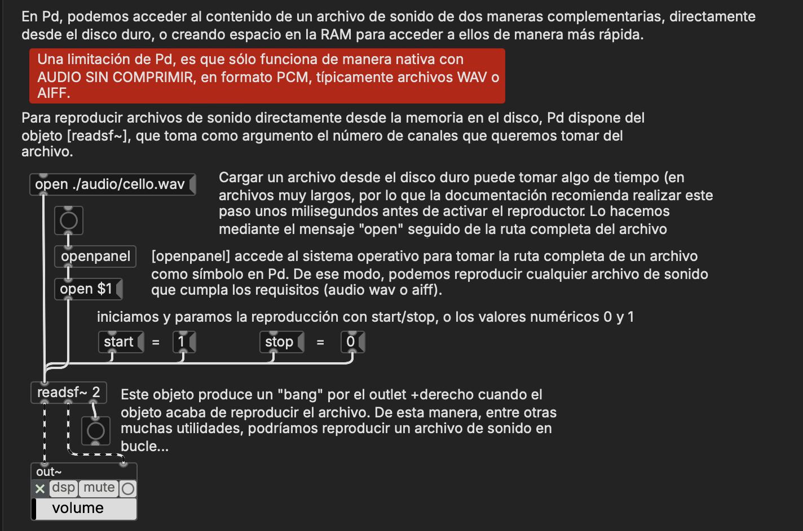{ .patch }

## Lo esencial de hoy

| Objetos | Para qué |
|---|---|
| `[sfload]` | Cargar un archivo de sonido (cualquier formato) en un `[array]`. Dice su tamaño (N) y su SR. |
| `[unpack]` | Separar una lista en sus elementos, de derecha a izquierda: N y SR de `[sfload]`, nota y velocidad de `[keymap]`. Lo contrario de `[pack]`. |
| `[openpanel]` · `$1` | Elegir un archivo con la ventana del sistema. `$1` en un mensaje: el primer elemento de lo que llega. |
| `[tabplay~]` | Oír la tabla tal cual, de principio a fin. |
| `[phasor~]` · `[*~ N]` | El índice en bucle: frecuencia = velocidad × SR / N. |
| `[tabread4~]` | Leer la tabla en el punto del índice, interpolando. Con `set nombre`, cambiar de tabla. |
| `[pow]` | Elevar: 2^(n/12), la velocidad de *n* semitonos. |
| `[vline~]` | El índice una vez: `comienzo, fin ms`. Y la envolvente contra los clics. |
| `[keymap]` · `[keyboard]` | El teclado del ordenador como teclado MIDI, y un teclado en pantalla. |
| `[stripnote]` | Solo las teclas que se pulsan. |
| `[adsr~]` | Una envolvente que abre con la tecla y cierra al soltarla. |

- **Un sonido es una tabla:** N muestras entre −1 y 1. Duración = N / SR.
- **Leerlo es recorrerlo con un índice,** como la partitura y la forma de onda de la S2.
- **Todo es velocidad:** 1 tal cual, 2 el doble, −1 al revés, 2^(n/12) para *n* semitonos. Velocidad y altura van juntas.
- **`[phasor~]` lee en bucle y habla en frecuencia;** `[vline~]` lee una vez y habla en tiempo. Una cuenta es la inversa de la otra.
- **Un *sampler* es un lector que se toca:** cada tecla, un comienzo, un fin y una duración.
- **Sin envolvente, clic.** Cada fragmento, con su entrada y su salida.

## Patches de referencia

[Descarga los patches de la sesión (zip)](../patches/peg-s3.zip). Son los patches de las capturas de esta página, para abrirlos y tocarlos: lo que no está aquí lo tienes en la documentación (ver «Para seguir por tu cuenta»). Los sonidos que usan están en [Sonidos de trabajo](../sonidos.md).

## Para seguir por tu cuenta

**Documentación de Pd**

- `3.audio.examples`: B01–B04 (tablas de ondas, `tabread4~`, interpolación), B07–B12 (*scratch*, bucles, bucle deslizante, transposición), B15–B16, C05 (*sampler* de un disparo).

**Live Electronics Tutorial (Porres)**

- *Sampling.Delay.Granulation › Sampling(buffer)*: `Play`, `Interpolation`, `Record`, `Sample-Synth`.
- *The Basics › Pd Quickstart › Elementary*: `Array`.
- *Control › Envelopes*: ADSR.
- *Basic-Processing › Fade.in.out*: fundidos para evitar clics.
- *The Basics › Digital.Audio › SampleRate*: frecuencia de muestreo, interpolación y remuestreo.

## Lecturas

- Cox, C. y Warner, D. (eds.) (2017). *Audio Culture: Readings in Modern Music* (ed. revisada). Antología de textos de compositores y teóricos, de la música concreta al *sampling*. [PDF](https://lamembrana.com/radio-katarina/lecturas/cox-warner-audio-culture.pdf)

## Encargo

[E3 · Sampler](../encargos/e3.md), para el sábado 28 de noviembre.
